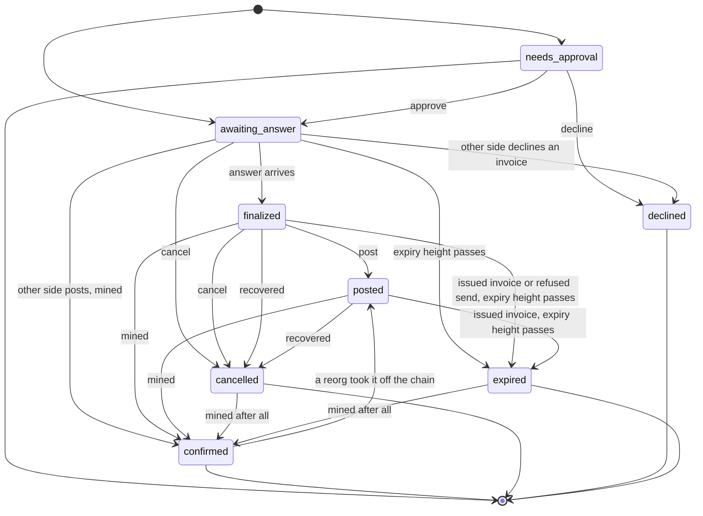

# The wallet API v1

Interactive version: [docs.btlabs.uk/developers/lepic/api/v1](https://docs.btlabs.uk/developers/lepic/api/v1/).

`lepic serve` holds one wallet open and answers an HTTP API under `/api/v1` on a Unix socket, and
on an owner TLS listener when that is on. This guide covers lepic 0.6.0. `lepic serve` runs on Unix only; on Windows the rest of the CLI runs but the API does not. The contract is
[openapi.json](openapi.json), document version 2.0.0 (the path stays `/api/v1`); `GET /api/v1/openapi.json` returns the same
document from a running serve. The
[explorer](https://docs.btlabs.uk/developers/lepic/api/v1/explorer/) has every endpoint with its
fields and answers. [Recipes](../recipes.md) has tasks with the CLI and the API side by side.

## First request

Start serve on a socket in the current directory; it reads the wallet password as `lepic` does.

```bash
lepic serve --socket ./w.sock &
```

Ask serve for its status.

```bash
curl --unix-socket ./w.sock http://lepic/api/v1/status
```

```json
{"version":"0.6.0","uptime_s":5,"listeners":{"epicbox":{"state":"connected","relays":[{"host":"relay.example:443","group":"wallet","state":"attached","push":true,"connected_since":"2026-11-11T02:55:09.512041201Z"}]}},"node":{"tip_height":3412790,"tip_changed_at":"2026-11-11T02:54:31.226402118Z"},"payments":{"open":{"needs_approval":0,"awaiting_answer":0,"finalized":0,"posted":0}},"refresh":{"failures":0,"last_success_at":"2026-11-11T02:55:09.797663717Z"},"collect":{"failures":0,"last_success_at":"2026-11-11T02:55:09.816610725Z"},"requests":{"served":0,"in_flight":1,"refused":0}}
```

Read the accounts and their balances.

```bash
curl --unix-socket ./w.sock http://lepic/api/v1/accounts
```

```json
{"items":[{"label":"default","index":0,"balance":{"spendable":"0.00000000","confirming":"0.00000000","pending":"0.00000000","maturing":"0.00000000","locked":"0.00000000","total":"0.00000000"}}]}
```

## Payment lifecycle

A payment is one object, whatever its kind: a send, an invoice you issue or pay, or a payment a
scan found. Its `state` moves like this:



| Status | Meaning | Calls in actions |
|---|---|---|
| `needs_approval` | An invoice someone handed you, held until you approve or decline it. Nothing is spent. Past its expiry height it drops out of the list. | `approve`, `decline` |
| `awaiting_answer` | The slate went out and the other side has not answered. A send you made, an invoice you issued, a payment you received or an invoice you approved. | `deliver` before its cutoff height for an outgoing payment not yet delivered or an epic1 payment whose post is `uncertain` or `failed`, `cancel` |
| `finalized` | The answer arrived and the transaction is built. Serve posts it to the node by itself. | `post` until its expiry height, `cancel`, `recover` for a send |
| `posted` | The node took the transaction. | `post` until its expiry height, `recover` for a send |
| `confirmed` | The transaction is on the chain. Within 1,440 blocks of its confirmation, a reorg that takes it off the chain reopens it: serve moves it back to `posted` (`received` for a payment you received, `sent` for a send not yet posted) and raises `payment.state_changed`. | none |
| `cancelled` | Ended without a transaction. `state_reason` is `by_us`, `by_them`, or `recovered` once a recovery is done. | `recover` for a send whose inputs are still held for it |
| `declined` | One side refused the invoice. `state_reason` says which. A send this wallet made that its receiver declines is erased instead: no payment is left, `GET /payments/{id}` answers 404 `payment_declined`, and `payment.declined` is raised. | none |
| `expired` | Ended at its expiry height. `state_reason` is `expired_no_answer` when the answer to a payment or invoice you started never came, `expired_not_mined` when it was answered but not mined, and `expired_rejected_by_node` for a send whose every push the node's pool refused. | `recover` for a send whose inputs are still held for it |

While serve is online, its refresh pushes a `finalized` payment to the node again until it is
mined or its expiry height passes: 1 block after the first push, 2 after the second, then 4, 8
and 16, then every 30 blocks. A `posted` payment whose transaction neither the node's pool nor
its chain holds is pushed again 10 blocks after the node last took it. A refresh that finds the
node unreachable stops pushing until the next one.

A `finalized` or `posted` send otherwise stays as it is past its expiry height, since another
node may still mine it. The exception is a send the node's own pool refused at every push, with
no push the node took and none that failed in another way, such as a timeout or a proxy's error
answer: once its expiry height passes and neither the node's pool nor its chain holds the
transaction, it ends `expired` with `state_reason` `expired_rejected_by_node` and its inputs are
spendable again. The wallet keeps watching its kernel, and a payment mined later after all
becomes `confirmed` with no reason. On a stem push a node can keep the transaction in its
stempool and still answer a pool error, and the pool check reads only the node's txpool; the
watch covers that outcome. `post` leaves `actions` once the wallet's last known height reaches
the expiry height, since the wallet no longer posts the payment from there.

A service that credits a customer back when a send ends can go by this table, for a payment of
`kind` `send` and `direction` `out`:

| `state` | `state_reason` | Can it still be mined | Credit back |
|---|---|---|---|
| `expired` | `expired_no_answer` | No: the answer never arrived, and only your wallet can finalize the send | Yes |
| `expired` | `expired_rejected_by_node` | Only by a node other than yours; it then becomes `confirmed` | Recover first, then credit: only once the `recover` action has ended it as `cancelled` with `recovered` (row below) |
| `expired` | `expired_not_mined` | Yes: the send was answered, and another node may still mine it | No |
| `cancelled` | `by_us`, while it was `awaiting_answer` | No | Yes |
| `cancelled` | `recovered` | No: the recovery spent its inputs | Yes |
| any other ended state | any | Yes | No |

A payment that becomes `confirmed` later counts as paid, even after `expired_rejected_by_node`. Never credit back on `expired_rejected_by_node` alone.
An `expired` payment has no `state_reason` only when the wallet holds neither its slate nor its
kernel, such as an entry imported from another wallet's history.

The wallet decides the reason from what it stored. The side that started the payment (the sender
of a send, the issuer of an invoice) holds the answer once it stored the answer's slate, knows the
final kernel, or pushed the transaction to the node. Without any of these the payment ends
`expired_no_answer`. Every other expiry, including each one on the side that answered, ends
`expired_not_mined`, unless `expired_rejected_by_node` applies.

### Post to the node

A payment carries a `post` object once its transaction was pushed to the node, by a `post` call
or by a refresh. A payment that waits for its answer has none.

| Field | Meaning |
|---|---|
| `post.attempts` | Pushes so far. |
| `post.last_outcome` | `accepted` (the node's pool took it), `refused` (the node answered an error) or `unreachable` (no answer). |
| `post.last_attempt_at` | When the last push was made. |
| `post.last_error` | The node's text for the last push that failed. |
| `post.next_attempt_height` | The height from which a refresh pushes it again; only while the payment is `finalized` or `posted`. |
| `post.accepted_once` | Whether the node's pool took any push of it. |

`last_error` stays after a later push is accepted. Read it with the other two fields: with
`last_outcome` `accepted` it is the refusal before, now resolved; with `accepted_once` false the
node has never taken the transaction.

The node's text is not trusted. The API passes it on as plain text, in payments, events and
webhooks: each control character is escaped (`\n`, `\u{1b}`), and so is each character that
reorders or hides text: zero-width characters, bidirectional overrides and isolates, the byte
order mark and the line and paragraph separators (`\u{202e}`, `\u{200b}`, `\u{2028}`). The text
is then cut to 256 characters, escapes counted, the last one `…` when it was cut. A node's
error is one line; the cap keeps every event and webhook that carries it small.
`recovery.error` is treated the same way.

### What a client sees

A payment shows four sets of values, each with its own event:

| Set | Field | Values | Event |
|---|---|---|---|
| Payment state | `state`, `state_reason` | the statuses above | `payment.state_changed` |
| Post outcome | `post.last_outcome` | `accepted`, `refused`, `unreachable` | `payment.post_failed` on a failure |
| Recovery | `recovery.state` | `uncertain`, `posted`, `confirming`, `done`, `failed` | `payment.recovery_changed` |
| Delivery | `delivery.state` | `by_hand`, `queued`, `sent`, `uncertain`, `failed` | `payment.delivery_changed` |

- `payment.state_changed` comes when `state` changes, with `from_state`, `to_state` and, for an
  end state, `reason`.
- `payment.post_failed` comes when a push of the transaction fails for the first time, and again
  each time the outcome or the node's text changes. `data.error` holds the text. It changes no
  state; a state change that comes with it is logged before it as `payment.state_changed`.
- `payment.recovery_changed` comes when `recovery.state` changes.
- `payment.delivery_changed` comes when the post of an epic1 payment turns `uncertain`, when it
  `failed` with no route tried next, and with `sent` when the payment goes out after an earlier
  post was `uncertain` or `failed`. `data` holds the payment, the `state` and the `route` it
  was posted on. `data.state` is the outcome of that post; the payment shows its delivery as it
  stood then, and `GET /payments/{id}` reads the current one. A payment that goes out on its
  first post raises none.

`POST /payments/{id}/deliver` on an epic1 payment posts it on the link's next `http` or `tor` entry,
and on the entries after it while each is refused or out of reach. A next route exists only for a
link with `http` or `tor` entries. Each entry waits at most the mailbox's connect and response limits,
15 s each by default, and a link holds at most three entries, the first already tried, so the call
can take up to 60 s; its outcome also arrives as `payment.delivery_changed`. It answers 409
`no_more_routes` when every entry was tried, and leaves the payment unchanged. A payment that went
to the payee's mailbox was posted to the mailboxes of its list on its first post, so the call
answers 409 `no_more_routes` for it, though its `actions` can list `deliver`. A payment past its
cutoff height has expired and offers no `deliver`.

The payer of an invoice and the receiver of a send never pass `finalized`: the other side posts, and
the payment goes from `awaiting_answer` to `confirmed`. Cancel on a `posted` send (`direction`
`out`) answers 409 `use_recover` and changes nothing: only a recovery spends its inputs again.
Cancel on any other `posted` payment, a recovery's self payment included, follows `actions` and
answers 409 `action_not_available`. Cancel on a payment that went out over an Epicbox relay offering
cancel also asks the relay to drop its slate, once; the answer does not depend on the relay, which
may be unreachable or refuse. A payment that expires at refresh asks the relay the same way; when
many expire together and the relay cannot be reached or cannot cancel, the rest are not asked. The
contract also names `awaiting_post`; serve sets no payment to it.

Rule: a client offers the calls a payment's `actions` field lists, and no others. Each is a POST
without a body or with a small one: `POST /payments/{id}/approve`, `POST /payments/{id}/decline`,
`POST /payments/{id}/deliver`, `POST /payments/{id}/post`, `POST /payments/{id}/cancel` and
`POST /payments/{id}/recover`. A call the list does not hold answers 409 `action_not_available`
and changes nothing, except `recover`, which [Recover a send](#recover-a-send) describes.

### Recover a send

`POST /payments/{id}/recover` is the last resort for a send the network may never mine. It needs
the full role and answers 202 with the payment. It spends all of the send's inputs back to this
wallet in one transaction, so the send can never be mined once the recovery is. Serve asks the
node first and refuses while the node's pool or chain holds the send.

`recover` is in `actions` for a send that is `finalized`, `posted`, `cancelled` or `expired`,
whose inputs are still held for it and that has no recovery open. A call can still answer 409
when the node holds the send. The call is not checked against `actions`: on a payment the list
does not name, it answers `not_recoverable` or `recovery_open` from the table below, never
`action_not_available`.

A wallet that serve runs without a node still lists `recover` on such a send. The call then
answers the node error, as any call that needs the node does, and stores nothing.

A recover call can answer an error after the recovery was stored. A retry then answers
`recovery_open`: read `recovery` on the payment to see where the recovery stands, and do not
recover again.

The recovery is an ordinary self-send transaction: a payment with `direction` `self` and `via`
`chain`. The send's `recovery` object names it:

| Field | Values |
|---|---|
| `recovery.tx_id` | The id of the recovery's self payment, the one the wallet sent. |
| `recovery.state` | `uncertain` (the node could not be reached; each refresh posts it again), `posted`, `confirming`, `done` or `failed`. |
| `recovery.confirmations`, `recovery.needed` | Confirmations so far, and the account's minimum confirmations at which it is `done`. |
| `recovery.fee` | The recovery's fee. |
| `recovery.error` | The node's answer to the last failed push, or why the recovery failed. |

Once the recovery is `done`, a send still open ends `cancelled` with `state_reason` `recovered`.
Pay again only after `recovered`: until then the send may still be mined. A recovery the node
refused is `failed` and changes nothing else; the send keeps its state and its inputs. A send the
chain mines first ends the recovery `failed`. While a recovery is open, the send and the
recovery's self payment list no `post` and no `cancel`. Each change of `recovery.state` raises
`payment.recovery_changed`.

The fee is 0.004 EPIC for 1 input, 0.003 EPIC for 2, 0.002 EPIC for 3 and 0.001 EPIC for 4 or
more. A send whose inputs total less than the fee cannot be recovered, and the node must accept
the recovery.

| 409 code | Meaning |
|---|---|
| `in_pool` | The node's pool holds the send. |
| `on_chain` | The chain holds the send. |
| `recovery_open` | The send has a recovery that is not `done` or `failed`. |
| `not_recoverable` | Any other payment: not a send, already mined, or its inputs are spent. |

## Endpoints by group

Every path is under `/api/v1`. Each operation's lowest role is its `x-role` in
[openapi.json](openapi.json); the [explorer](https://docs.btlabs.uk/developers/lepic/api/v1/explorer/)
shows it per call.

| Group | Calls | What it covers |
|---|---|---|
| Service | `GET /status`, `GET /metrics`, `GET /openapi.json` | Uptime, listeners, the node's tip, last refresh and collect, see [Health](#health); the same kind of facts as Prometheus text, see [Metrics](#metrics); this API as OpenAPI 3.1 |
| Payments | `GET /payments`, `POST /payments`, `POST /payments/estimate`, `GET /payments/{id}`, `PATCH /payments/{id}` | List, send, invoice, fee estimate, local notes |
| Payment actions | `POST /payments/{id}/approve`, `POST /payments/{id}/decline`, `POST /payments/{id}/deliver`, `POST /payments/{id}/post`, `POST /payments/{id}/cancel`, `POST /payments/{id}/recover` | The calls `actions` lists, see [Payment lifecycle](#payment-lifecycle) |
| Hand over | `GET /payments/{id}/handoff`, `POST /inspect`, `POST /open` | Text, files and QR frames given by hand: what to give, what you got, act on it |
| Addresses and links | `GET /addresses`, `POST /links` | Addresses to give out, request links |
| Contacts | `GET /contacts`, `POST /contacts`, `GET /contacts/{id}`, `PATCH /contacts/{id}`, `DELETE /contacts/{id}`, `POST /contacts/{id}/verify`, `POST /contacts/{id}/check`, `POST /contacts/{id}/keys`, `POST /contacts/{id}/move`, `POST /contacts/{id}/payloads`, `POST /contacts/export`, `POST /contacts/import` | Pairing, the four-word check, key changes, relay moves, bytes for the host app, backup |
| Contact inbox | `GET /payloads`, `DELETE /payloads/{id}`, `GET /quarantine`, `POST /quarantine/{id}/retry`, `DELETE /quarantine/{id}` | Payloads received, messages that did not open |
| Wallet | `GET /wallet`, `PUT /wallet/password`, `POST /wallet/scan`, `GET /accounts`, `POST /accounts`, `GET /outputs`, `POST /outputs/consolidate` | Height, scan, password, accounts and balances, coins, consolidation |
| Sync | `POST /sync`, `POST /sync/boost`, `DELETE /sync/boost/{id}` | Refresh from the node and collect from the mailboxes now, or more often for a while |
| Mailboxes | `GET /mailboxes`, `POST /mailboxes`, `POST /mailboxes/probe`, `DELETE /mailboxes/{host}` | The wallet's mailbox list |
| Network and profile | `GET /relay`, `POST /relay/move`, `GET /node`, `GET /profile`, `PATCH /profile`, `GET /profile/domain-file` | Home mailbox, node, what contacts are told |
| Events | `GET /events`, `GET /webhook`, `POST /webhook/resume` | The event log as pages, a live stream or webhooks |

## Health

`GET /status` gives a monitor facts and no verdicts: it compares them with its own thresholds.
It reads what serve holds in memory and a few indexed counts from the wallet's store, and asks
the node nothing, so a monitor may call it as often as it likes.

| Field | What it says |
|---|---|
| `refresh.last_success_at`, `refresh.failures` | When the wallet last refreshed from the node, and the failures in a row since. |
| `node.tip_height` | The node's tip at the last refresh that reached the node. |
| `node.tip_changed_at` | When a refresh first saw that tip. When it grows old while `refresh.last_success_at` stays recent, the node answers but no longer follows the chain. |
| `listeners.epicbox.relays[]` | One entry for each push session: `host` (`domain:port`), `group`, and `state` (`connecting`, `attached`, `waiting`, `not_offered`, `stopped`). A mailbox that answered without mux/1 stays listed as `not_offered` until serve stops. A mailbox that has not answered the greeting yet is not listed. |
| `relays[].push` | Whether the mailbox offers mux/1; `false` with `not_offered`, where serve reads the payments address on a plain socket and reads no contact, pairing or epic1 mail. Absent before the mailbox answered. |
| `relays[].last_error` | Why the session last lost its socket, as plain text cut to 256 characters. Absent once it attached again. |
| `relays[].connected_since` | Since when the session is attached; absent while it is not. |
| `relays[].last_mail_at` | When the mailbox last pushed mail to the session. |
| `payments.open.needs_approval` | Invoices that wait for approval. |
| `payments.open.awaiting_answer`, `.finalized`, `.posted` | Payments in each of those states, over every account; the same counts as `GET /payments?state=...`. Ended payments are not counted. |
| `payments.oldest_awaiting_answer`, `payments.oldest_finalized` | `{id, since}` of the payment in that state created first, `since` being its `created_at`; absent when there is none. A send that waits long for its answer or a finalized one that never posts shows here first. |

`payments.open.needs_approval` counts every parked invoice, so it can exceed the
`needs_approval` listing by an invoice whose slate does not decode or one from a contact
whose note is missing.

The `node` fields and the times of a mailbox are held by the running serve: they are absent until
serve sees them, and again after serve restarts.

## Metrics

`GET /metrics` answers the Prometheus text format (`text/plain; version=0.0.4; charset=utf-8`),
role `read`. It is off unless serve runs with `--metrics`; without it the path answers 404
`not_found`. Like `GET /status` it reads serve's memory and the store, asks the node and the
mailboxes nothing, and may be called as often as a scraper likes. It builds the view of each
payment that is not over, so that `lepic_payments_stuck` and `lepic_outbox_queue_depth` read the
same `delivery` as `GET /payments`. Names start with `lepic_`,
amounts are in the wallet's base unit (1e-8 EPIC) and counters end in `_total`. They start at 0
when serve starts. The families, their labels and a sample are in the
[CLI guide](../cli.md#metrics); how to scrape a Unix socket is there too.

## Connecting

One serve holds one wallet, and no path names a wallet. To serve two wallets, run two serves with
their own sockets.

### The Unix socket

| Item | Value |
|---|---|
| Path | `lepic.sock` in the data directory, unless `--socket` says otherwise |
| Access | Owner only (mode 0600); there are no tokens |
| URL host | Ignored; use `lepic` |
| Role | Always `full` |
| Every answer | Carries `x-lepic-version` |

### Owner TLS

A client on another machine needs `[api] owner_tls = "ip:port"` in settings.toml and
`lepic serve --owner-tls`. Serve writes its certificate to `api-tls.pem` in the data directory.
The client trusts that file and presents a certificate of its own with an Ed25519 key. List the
client with its role:

```bash
lepic api client add till ./till-cert.pem --role receive
```

The file format and the other commands are in the [CLI guide](../cli.md#owner-api-over-tls).

| Role | May |
|---|---|
| `read` | The calls that read the wallet. The default. |
| `receive` | Also create invoices, addresses and links, take payments, and finish the invoices this wallet issued: open the answer, post it, cancel one still waiting for its answer. |
| `full` | Everything the TLS listener answers. |

| Over TLS | Answer |
|---|---|
| A call above the client's role | 403 `role_required` |
| `PUT /wallet/password`, `POST /contacts/export`, `POST /contacts/import` | 403 `socket_only` |
| A payment created without an `id` | 400 `invalid_field` at `/id` |
| A send or a `deliver` to an address of the computer serve runs on | 400 `invalid_request` |
| A client removed from `api-clients` after it connected | 403 `client_not_listed` |

`POST /payments` needs `full` for a send and `receive` for an invoice.

## Conventions

| Topic | Rule |
|---|---|
| Names | Fields are snake_case. Enum values are lower snake_case. A client accepts enum values it does not know. |
| Ids | A payment's `id` is a UUID, its slate id. A send `id` chosen by the caller must be a random version-4 UUID; another UUID version is refused with 400 `invalid_request`. Other ids are opaque strings. |
| Amounts | Decimal strings in EPIC with up to 8 decimals: `"1.5"`, `"0.00000001"`. Never a number. |
| Times | RFC 3339 in UTC: `2026-11-11T01:51:28.040280091Z`. The fraction has up to 9 digits. |
| Optional fields | Left out when empty. Never `null`. |
| Bodies | JSON with `content-type: application/json`. A field the document does not name is 400 `invalid_body`. |
| Lists | `{"items": [...], "next_cursor": "..."}`. `limit` is 1 to 500, default 50. |

To page a list, pass `next_cursor` back as `cursor`. It is missing on the last page. A cursor is
bound to the list's other query parameters, so they stay the same across pages.

### Repeating a create

A create (payment, contact) may carry an `id` the caller chooses; for a payment it
is a UUID (for a send, a version-4 UUID). Serve records a digest of the body before it creates anything, so a repeat of the call
does not create a second object.

| You send | Serve answers |
|---|---|
| The `id` for the first time | 201 with the new object |
| The same `id` and the same body | 200 with the stored object |
| The same `id` and another body | 409 `idempotency_mismatch` |
| The same `id` while the first call is still being answered | 409 `in_progress` with `Retry-After` |
| A new payment `id` while serve makes as many payments as it takes connections | 503 `busy` with `Retry-After`; nothing is made or kept |

- A payment with an `id` goes on being made when its caller leaves. A repeat after the end
  answers 200 with the payment and its `handoff`.
- Serve waits for running payment creates to end before it stops. A create the stop cuts short
  answers 503 `interrupted`, its record is kept, and a repeat makes the payment.
- Payments with an `id` count against the built-in connection limit of the API (not a setting) while they are made, so serve makes
  at most that many at once. Over it a new create answers 503 `busy` and counts in
  `requests.refused` of `GET /status`. A repeat of a payment that exists is answered at any
  count.
- A create with an `id` that is refused with a 4xx, or answers a 502 from the node, made nothing and
  keeps no record: the same `id` with a corrected body is a new create.
- A create without an `id` (socket only) can answer 502 `not_delivered` or 422 after the payment was
  stored, and the answer names no payment. Its coins stay locked until the send ends. Send an `id` on every payment
  that moves coins: only a repeat with the same `id` is safe.
- A 201 does not mean the payment is open. Read its `state`: a create whose slate file could not be
  written answers 201 with the payment already `cancelled`, and it keeps the `id`.
- After a 500 or 503 the object may exist: repeat the same body to find out. This holds after
  serve stopped while answering, too.
- Over TLS a payment must carry an `id`, so a client that loses the answer can ask again.
- A send keeps the caller's `id` as the payment's `id`, and so does an invoice whose `id` is a
  version-4 UUID. An invoice under any other UUID gets an `id` of the wallet's own choosing, and
  the caller's `id` is an alias that `GET /payments/{id}` also answers.

```bash
curl -i --unix-socket ./w.sock -H 'content-type: application/json' \
  -d '{"id":"till-1","method":"invite","label":"Till 1"}' http://lepic/api/v1/contacts
```

The first call answers `201 Created`, the same command again `200 OK` with the same contact. The
same `id` with another body answers:

```json
{"type":"about:blank","title":"Conflict","status":409,"detail":"this id was used before with another request body","code":"idempotency_mismatch","category":"conflict","param":"/id"}
```

## Fields that steer a client

A payment carries these. The [Payment lifecycle](#payment-lifecycle) covers `state` and
`actions`.

| Field | Values |
|---|---|
| `kind` | `send`, `invoice`, `coinbase`, `unknown` (found by a scan). Only `send` and `invoice` can be created. |
| `direction` | `in`, `out`, `self` (between your own accounts, or splitting your own coins). |
| `confirmations`, `final` | Present once the payment is on the chain. `confirmations` counts blocks on top of it; `final` turns true when they reach the `final_confirmations` setting (6 unless set, 1 to 1440). `confirmed` means one confirmation. Credit a received payment when `final` is true, or on the `payment.confirmations_reached` event. A reorg can still reopen a `confirmed` payment for 1,440 blocks, so watch for `payment.state_changed` away from `confirmed` until then. |
| `state_reason` | Why a payment reached an end state: `by_us`, `by_them`, `recovered` and others. |
| `via` | How the slate travels: `epicbox`, `http`, `tor`, `contact`, `link`, `in_person`, `file`, `peer`, `chain`. A payment made through an epic1 address or link shows `link`, and `counterparty.address` holds the address. Older payments show it too. |
| `delivery.state` | Serve sets `by_hand` (handed over as text or a file), `queued` (an epic1 post waits for its turn), `uncertain` (it went out and is not known to have arrived), `failed` (an epic1 post failed on its last route) and `sent`. A send the receiver refused reads `sent`. A send cancelled before any route took its slate reads `uncertain` with `undelivered: true`, and keeps `delivery.error`. |
| `handoff` | On a create or an open: the text, file name and QR frames to give the other person by hand. |
| `expires_at_height` | The height after which an invoice expires. |
| `recovery` | On a send: its latest recovery, see [Recover a send](#recover-a-send). |

`GET /payments` lists payments newest first and filters by `state`, `kind`, `direction`, `via`,
`account`, `contact_id`, `delivery` and `updated_after`. `updated_after` compares the time of the last change of the payment's entry; a change of `delivery`, `metadata` or `post` does not move it.

### Create a payment

`POST /payments` starts a send (`kind` left out or `send`) or an invoice (`kind: invoice`). The
main fields:

| Field | Meaning |
|---|---|
| `id` | Caller-chosen UUID. See [Repeating a create](#repeating-a-create). |
| `to` | Where it goes, below. |
| `via` | Names the route to check against `to`, or `file` when there is no `to`. A `via` that differs from the route of `to` answers 400 `via_mismatch`. It never changes the route. |
| `amount` | Decimal string. May be left out when `to` is an `epic:` link that names one. |
| `account` | Account label. The default account when left out. |
| `message` | Signed into the slate, up to 256 bytes. The other party sees it as `their_message`. |
| `deliver` | `false` makes the payment and returns the `handoff` without sending it. |
| `metadata` | Up to 50 local notes, never sent. `PATCH /payments/{id}` changes them. |

The explorer lists the rest: `min_confirmations`, `selection`, `change_outputs`, `ttl_blocks`,
`fluff`, `purpose`, `allow_plain_http`. `POST /payments/estimate` takes the same body and answers
the `fee`, `max_amount` and `outputs` without changing anything. A field the body does not list,
`legacy` among them, answers 400 `invalid_body`.

When `to` is an Epicbox address, the estimate and the send's create response also carry
`slate_bytes` and `slate_limit`: the bytes the payment's longest post takes on the mailbox (the
first slate, or the answer the receiver sends back) and the most the mailbox takes, 131,071. Over
the limit both answer 400 `slate_too_large` with `bytes`, `limit` and `inputs`, and nothing is
stored.

| `to` | Route |
|---|---|
| `KEY@HOST` | Epicbox address |
| `http://` or `https://` URL | HTTP listener of another wallet |
| `.onion` address | Tor, started from the settings' tor binary: 400 when the settings name none or only a running tor's SOCKS address, 500 `config` when the named binary is missing |
| `epic:` link | Classic (`epic:ADDRESS?amount=&message=`), paid to its address at its amount, or epic1, paid as `lepic epic1 pay` pays it, at the `amount` and `message` given or the link's |
| `contact:CONTACT_ID` | A paired contact |
| `account:LABEL` | One of your own accounts: serve answers 400 `invalid_field` |

Without `to`, `via` must be `file`, or `deliver` must be `false`: the payment is made for someone
you hand it to.
`via` set to `in_person`, `peer` or `chain` answers 400 `invalid_field`; `link` is accepted for an epic1 `to`.

An invoice goes to `contact:CONTACT_ID`, or is handed back with `via: file` or `deliver: false`.
An invoice to an Epicbox, http(s) or onion address, or to a classic `epic:` link, answers 400
`invoice_to_address` at `/to`, and nothing is stored. To an epic1 link it answers 400
`invalid_field`.

```bash
curl --unix-socket ./w.sock -H 'content-type: application/json' \
  -d '{"id":"5b0e2f6a-3c1d-4e8f-9a7b-2d4c6e8f0a1b","amount":"1","to":"KEY@epicbox.example"}' \
  http://lepic/api/v1/payments
```

A repeat of a send its receiver declined answers 404 `payment_declined` with `declined_at`, and
stores nothing.

The answer is 201 with the payment in `awaiting_answer`. When the other wallet answers, serve
finishes and posts it by itself.

A second send can fail with 422 `insufficient_funds` while the first is unconfirmed: the change of
a send stays locked until its transaction confirms. The amount plus the fee must fit in
`spendable` of `GET /accounts`.

### Hand over and open

A payment made with `via: file` or `deliver: false` carries a `handoff`: give its `text` to the
other person, or save it under `file_name`. `GET /payments/{id}/handoff` returns it again;
`?qr=true` adds `qr_frames`. A plain slate handed over by hand is rebuilt from the stored slate
when serve no longer keeps the text, byte for byte the same, while the payment waits for the
other side.

`POST /open` takes what someone handed you: pasted `text`, a file as `file_base64`, or scanned
`qr_frames`. It receives a payment, finishes yours, holds an invoice for approval or advances a
pairing, and says which in `outcome`. It never spends. `POST /inspect` takes the same and only
says what it is. `expect` on either lists the kinds to accept; anything else answers 422
`unexpected_input`. `POST /inspect` and `POST /payments/estimate` refuse a damaged epic1 address as
a payment to it is refused.

An invoice handed to you is held in `needs_approval`. Check `amount` and the issuer, then pay it
with the amount typed again:

```bash
curl --unix-socket ./w.sock -H 'content-type: application/json' \
  -d '{"amount":"3"}' http://lepic/api/v1/payments/PAYMENT_ID/approve
```

Another amount answers 400 `invalid_field` at `/amount` and the invoice stays held.
`POST /payments/{id}/decline` refuses it and tells the issuer.

## Addresses, links and contacts

`GET /addresses` lists the addresses to give out: the one epic1 address of each account and
the legacy Epicbox address, which belongs to the default account. `POST /links`
makes a request link: the account's epic1 address with an optional amount and message. It stores
nothing, and the same body gives the same link. A payment to a link arrives at the account's
address like any other; the wallet does not match it to the link. A shop credits an order by the
payment's amount and message, both written by the payer, so the message should name the order.

A contact is a paired wallet; a pairing in progress is a contact in state `waiting`.
`POST /contacts` starts a pairing by `method`:

| `method` | Inputs | Does |
|---|---|---|
| `invite` | `label`, `class`, `expires_in` (`1h`, `24h`, `7d`) | Makes an invite. The contact's `pairing.invite_link` goes to the other side. |
| `accept` | `invite`, `label`, `class`, `deliver` | Answers an invite. `deliver: false` returns the reply to hand over. |

When both screens show the same four words (`verify_words`), `POST /contacts/{id}/verify` with
`{"result":"match"}` completes the check. A contact that moved its mailbox shows
`requested_relay`; `POST /contacts/{id}/move` answers it. The wallet never moves on its own.

With a contact, `POST /payments` takes `"to":"contact:CONTACT_ID"`. An invoice from a contact
arrives in `needs_approval` when the contact is verified and `allow_invoices` is on; otherwise
the wallet declines it. An invoice to a contact goes only to a verified one, and to a paired
contact not verified answers 409 `contact_not_verified`.

## Consolidate outputs

`POST /outputs/consolidate` (role `full`) spends the wallet's outputs to itself as fewer
outputs, for the usual fee. It answers 201 with the payment it made, `direction: self`.

| Field | Meaning |
|---|---|
| `max_inputs` | The most outputs to spend, the smallest first; default 500 |
| `inputs` | Commitments of the outputs to spend instead; not with `max_inputs`. One that cannot be spent fails the call with 400 `invalid_field`, `param` `/inputs/N`, and nothing is stored |
| `outputs` | Outputs to make, of nearly equal value; 1 to 10, default 1 |
| `dry_run` | `true` answers 200 with an estimate and stores and locks nothing |
| `account`, `min_confirmations` | As for a send |
| `id` | As for a payment create, see [Repeating a create](#repeating-a-create); it becomes the payment's id. Required over owner TLS. A dry run ignores it |

Locked outputs, under-confirmed outputs and coinbase outputs not yet mature are left alone. A
consolidation links its inputs to each other on chain.

LEPIC holds no trigger, threshold or schedule for it. Read `GET /outputs` and call it when your
own threshold or schedule says so.

Check the fee first, then consolidate under an id that a retry reuses:

```bash
curl --unix-socket ./w.sock -X POST http://lepic/api/v1/outputs/consolidate \
  -H 'Content-Type: application/json' -d '{"dry_run":true,"max_inputs":200}'
curl --unix-socket ./w.sock -X POST http://lepic/api/v1/outputs/consolidate \
  -H 'Content-Type: application/json' \
  -d '{"id":"0c7d1e2f-4a5b-4c6d-8e9f-a0b1c2d3e4f5","max_inputs":200}'
```

## Collect, refresh and boosts

Serve reads contact, pairing and epic1 mail as a mailbox that offers mux/1 pushes it, at most once a
second; on a mailbox without mux/1 that mail is not read. Every 30 seconds it also asks each push
session how much mail waits and reads it, which ends the pairings whose slots were read after
their deadline, counts the wait of contacts not heard from and reports mailboxes that do not answer.
Each of these runs ends what expired and posts the outbox rows and replies that fell due. Serve
refreshes the wallet from the node every 60 seconds. `GET /status` shows the mailbox runs under
`collect` and the refreshes under `refresh`. `POST /sync` runs both now: it refreshes, reads what
waits and posts what is due. A node tip more than 60 blocks past the last confirmed one is taken
only when a later answer agrees, so after a long time offline `POST /sync` can answer the old height
once.

`POST /sync/boost` makes one poller run faster for a while, for a client that expects an answer:

```bash
curl --unix-socket ./w.sock -H 'content-type: application/json' \
  -d '{"poller":"relays","duration_seconds":120,"interval_seconds":5}' \
  http://lepic/api/v1/sync/boost
```

```json
{"id":4815162342108,"poller":"relays","until":"2026-11-13T16:02:10Z","interval_seconds":5}
```

The window is at most 600 seconds and the interval at least 5. A `relays` boost runs the
30-second run more often. `DELETE /sync/boost/{id}` ends a boost early. Serve boosts `relays` by
itself after `POST /payments` and `POST /contacts`.

## Events

Serve keeps an event log. Each event has a rising integer `id`, a `type`, a `created_at` and a
`data` object, which holds a snapshot of the object after the change where there is one.

| Group | Types |
|---|---|
| Payments | `payment.created`, `payment.state_changed`, `payment.updated`, `payment.confirmations_reached`, `payment.recovery_changed`, `payment.post_failed`, `payment.delivery_changed`, `payment.declined` |
| Contacts | `contact.created`, `contact.state_changed`, `contact.updated`, `contact.removed`, `payload.received`, `quarantine.added` |
| Wallet | `account.balance_changed`, `wallet.progress`, `relay.updated`, `slate.unmatched`, `slate.refused` |
| Log | `events.skipped` |

The set is open: skip a type you do not know.

`GET /events` returns a page, oldest first. `after` is the last id you have; `types` takes a comma
list and allows `payment.*`. A `types` filter always includes `events.skipped`.

```bash
curl --unix-socket ./w.sock 'http://lepic/api/v1/events?after=0&limit=50'
```

```json
{"items":[{"id":1,"type":"relay.updated","created_at":"2026-11-11T02:55:20.040280091Z","data":{"changed":["connection"],"object":{"host":"HOST","connection":"connected"}}}]}
```

With `Accept: text/event-stream` the same path streams. To resume after a disconnect, send the
last id you saw as `Last-Event-ID`:

```bash
curl -N -H 'Accept: text/event-stream' -H 'Last-Event-ID: 42' \
  --unix-socket ./w.sock http://lepic/api/v1/events
```

```text
id: 43
event: payment.state_changed
data: {"id":43,"type":"payment.state_changed",...}
```

Events are kept for 30 days. A client that falls behind, or asks from an id that is
pruned, gets an `events.skipped` event with the count and a `reason` of `lagged` or `pruned`. Read
the objects again with a `GET`, then carry on from the new id.

## Webhooks

A webhook is the event log sent by HTTP POST, for a service that cannot hold a connection open.
It carries the same events, ids and types as `GET /events`. One endpoint is set by these keys
in `config.toml`, or by their `LEPIC_*` variables (see
[Configuration](../configuration.md#keys)):

| Key | Meaning |
|---|---|
| `webhook_url` | The endpoint. `https://` only |
| `webhook_secret_file` | A file only its owner can read, one `whsec_` secret per line |
| `webhook_types` | The event types to send, as `GET /events` takes them. All when unset. `events.skipped` is always sent as well, so a filter holds at most 31 patterns unless it names it |
| `webhook_allow_private` | `true` allows `http://` and a loopback, private or link-local address |

Serve does not start when a key is wrong. A new `webhook_url` starts at the newest event.

Each request is one event; the body is the `GET /events` item. The headers follow
[Standard Webhooks](https://www.standardwebhooks.com/):

| Header | Value |
|---|---|
| `webhook-id` | `evt_`, 16 hex digits, `_` and the event id. A retry sends the same id: drop a duplicate by it |
| `webhook-timestamp` | Unix seconds of this attempt |
| `webhook-signature` | `v1,` and a base64 signature for each secret in the file, space-separated |

The signature is the HMAC-SHA256 of the text `webhook-id.webhook-timestamp.body` with the secret's
bytes, which are the base64 text after `whsec_`, decoded. A request is genuine when one of the
`v1,` values matches; compare in constant time.

To rotate, add the new secret as a second line, switch the receiver, then remove the old line.

Any 2xx is delivered; anything else is retried on a schedule, in id order, so a failing event holds
back the ones after it. When the schedule runs out the webhook is `disabled`. `GET /webhook` shows
the `state` (`active`, `retrying`, `config_error`, `disabled`), the `cursor` and `last_error`.
`POST /webhook/resume` sends again, from `after` when given:

```bash
curl --unix-socket ./w.sock -H 'content-type: application/json' \
  -d '{"after":41}' http://lepic/api/v1/webhook/resume
```

The [explorer](https://docs.btlabs.uk/developers/lepic/api/v1/explorer/) has the retry schedule,
the address ranges serve refuses, and the fields of `data.object` in a webhook.

## Errors

An error is an RFC 9457 problem document with `content-type: application/problem+json`:

```bash
curl -i --unix-socket ./w.sock http://lepic/api/v1/nothing
```

```json
{"type":"about:blank","title":"Not Found","status":404,"detail":"no such path","code":"no_route","category":"not_found"}
```

- `code` is a stable, fine-grained name. A client accepts codes it does not know and falls back
  on `category`.
- `category` is one of `usage`, `config`, `wrong_password`, `wallet_state`, `not_found`,
  `rejected`, `funds`, `node`, `transport`, `internal`, `interrupted` and `conflict`.
- `param` is a JSON pointer to the bad field, when one field is to blame.
- 409 `in_progress`, 502, 503 and 504 carry `Retry-After` when waiting is worth it.
- A method a path does not take is 405 `method_not_allowed` with an `Allow` header.

The codes most clients meet:

| Code | Status | Meaning |
|---|---|---|
| `invalid_field` | 400 | One field is wrong; `param` points at it. |
| `slate_too_large` | 400 | The payment needs too many inputs for the mailbox; the problem carries `bytes`, `limit` and `inputs`. |
| `role_required` | 403 | The TLS client's role is below what the call needs. |
| `not_found` | 404 | No object has that id. |
| `action_not_available` | 409 | The payment's `actions` do not list the call. |
| `idempotency_mismatch` | 409 | The `id` was used before with another body. |
| `no_more_routes` | 409 | `deliver` on an epic1 payment whose every route was tried. |
| `in_progress` | 409 | A create with this `id` is still being made; `Retry-After` says when to ask again. |
| `insufficient_funds` | 422 | The account cannot pay the amount and the fee. |
| `node_unreachable` | 502 | The node did not answer. |
| `transport_failed` | 502 | The mailbox or the other wallet could not be reached. |
| `busy` | 503 | Serve makes as many payments as it takes connections; `Retry-After` says when to ask again. |

The description of `code` in [openapi.json](openapi.json) lists the common codes with their status; a code it does not list takes the status of its category.

## The public listener

`serve --http` is open to other wallets, so it answers only two paths: `/v2/foreign` for stock
wallets and `/api/v1/inbox` for LEPIC wallets, the second only with `epic1_web_listener` on.
Anything else, including the rest of `/api/v1`, answers 404 there. `lepic tor listen` answers
the same two paths at the wallet's onion address, the second only with `epic1_onion_listener`
on. The wallet API is on the socket and the owner TLS listener only.

## Upgrade from 0.5.0

1. Stop `lepic serve`.
2. Copy the data directory. The upgrade is one way, and a 0.5.0 build refuses the upgraded wallet.
3. Start 0.6.0. The first command that opens the wallet moves the store to schema 22.
4. Check `GET /status` for the new `version`, and `GET /mailboxes` for the mailbox list.

epic1 addresses, links and payments made by 0.5.x are not readable by 0.6.0. Make new ones with
`GET /addresses` or `POST /links`, and give your payers those. A copy of the data directory older
than the wallet's last use needs `POST /wallet/scan` after it is restored; see
[Backup](../cli.md#backup).
