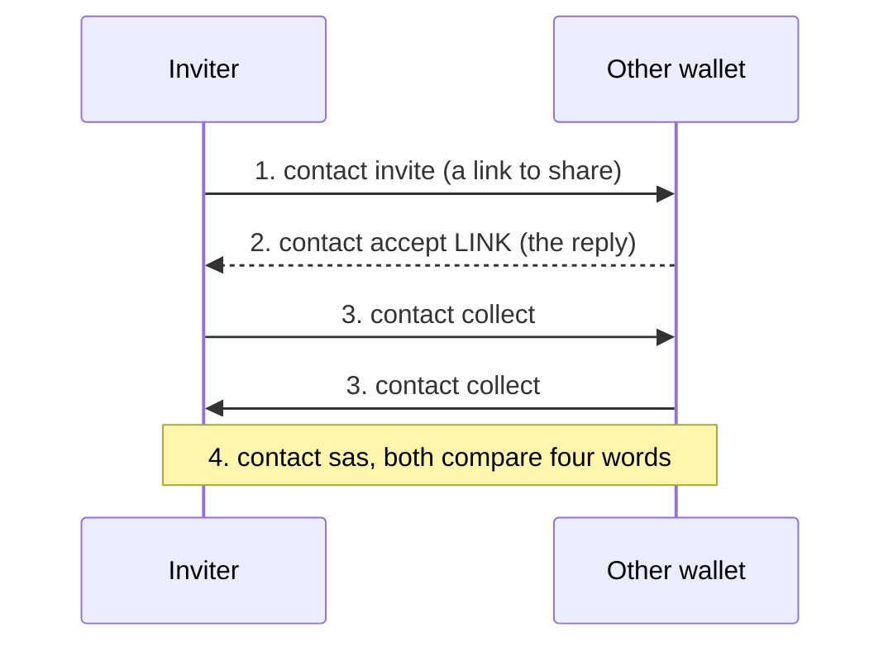

# The lepic command-line wallet

Interactive version: [docs.btlabs.uk/developers/lepic/cli](https://docs.btlabs.uk/developers/lepic/cli/).

`lepic` is the command-line wallet built on LEPIC, for use at a terminal, in scripts and by
services. It creates and restores Epic Cash wallets, sends and receives over Epicbox, HTTP, Tor and
slate files, pairs with contacts, and runs as a service with a local REST API. Settings come from
flags, `LEPIC_*` variables and two optional files. Reports go to stdout as text or JSON, with a
documented exit code.

This page describes `lepic 0.6.1`. Every option is also in `lepic COMMAND --help`. Settings files
are in [Configuration](configuration.md), task-by-task examples with the matching API calls in
[Recipes](recipes.md).

## Start here

1. **Build it.** `lepic` is the binary of the `lepic-cli` crate; the workspace needs Rust 1.100 or
   later.

   ```bash
   cargo build --release -p lepic-cli      # prints lepic 0.6.1 from ./target/release/lepic --version
   ```

2. **Set the password source.** Commands that open the wallet read the password from a file, a
   variable, a hidden prompt or standard input ([details](#password-and-other-secrets)).

   ```bash
   printf 'example-password-1\n' > ./password && chmod 600 ./password
   export LEPIC_PASSWORD_FILE=$PWD/password
   ```

3. **Create a wallet.** The recovery phrase is printed once ([Wallet](#wallet)).

   ```bash
   lepic wallet init
   ```

4. **Receive.** Give the sender the Epicbox address and keep a listener running ([Receive](#receive)).

   ```bash
   lepic wallet address && lepic epicbox listen
   ```

5. **Send.** The amount is in EPIC ([Send](#send)).

   ```bash
   lepic tx send 1.5 --to ADDRESS@HOST
   ```

6. **Check the balance and the history** ([After the send](#after-the-send)).

   ```bash
   lepic wallet info && lepic tx list
   ```

7. **Pair a contact.** One side invites, the other accepts, both collect and compare four words
   ([Contacts and pairing](#contacts-and-pairing)).

   ```bash
   lepic contact invite --name Shop
   ```

8. **Use it from a program.** `lepic serve` holds the wallet open and answers the
   [wallet API](api/README.md) on a local socket ([serve](#lepic-serve-and-the-wallet-api)).

   ```bash
   lepic serve
   ```

Every failure ends in an [exit code](#exit-codes). `--output json` prints every report as JSON
([Output formats](#output-formats)).

## Find a command by job

| I want to | Run | More |
|---|---|---|
| Create a wallet | `lepic wallet init` | [Wallet](#wallet) |
| Restore a wallet from its recovery phrase | `lepic wallet restore` | [Wallet](#wallet) |
| Get paid by anyone with an Epic wallet | `lepic wallet address` then `lepic epicbox listen` | [Receive](#receive) |
| Pay an address | `lepic tx send 1.5 --to ADDRESS@HOST` | [Send](#send) |
| Pay with no network between us | `lepic tx send 1.5 --to-file ./payment.slate` | [Send](#send) |
| Ask someone for an amount | `lepic invoice issue 2 --to-file ./invoice.slate` | [Invoices](#invoices) |
| Pay and get paid by the same people often | `lepic contact invite --name Shop` | [Contacts and pairing](#contacts-and-pairing) |
| Take a payment face to face | `lepic in-person invoice AMOUNT` | [In-person codes](#in-person-codes) |
| Put a payment link on a page or a sign | `lepic epic1 link 5 --qr` | [epic1 links](#epic1-links) |
| Keep proof that an epic1 address took a payment | `lepic proof export TX_ID --out proof.json` | [Payment proofs](#payment-proofs) |
| See what happened to a payment | `lepic tx list` then `lepic tx show TX_ID` | [After the send](#after-the-send) |
| Finish a send that ended with exit code 11 | `lepic tx resend TX_ID --to ADDRESS@HOST` | [After the send](#after-the-send) |
| Run the wallet for a program | `lepic serve` | [serve](#lepic-serve-and-the-wallet-api) |
| Let an app on another machine call the API | `lepic serve --owner-tls` then `lepic api client add NAME CERT_FILE` | [Owner API over TLS](#owner-api-over-tls) |

## Commands at a glance

### The ten everyday commands

| Command | What it does |
|---|---|
| `lepic wallet init` | Creates a wallet and prints its recovery phrase once |
| `lepic wallet info` | Refreshes against the node and shows balances |
| `lepic wallet address` | Shows the Epicbox address others pay |
| `lepic epicbox listen` | Stays connected to the relay and answers payments |
| `lepic tx send` | Pays with `--to`, `--to-file` or `--to-contact` |
| `lepic tx list` | Lists the account's transactions |
| `lepic tx show` | Shows one transaction |
| `lepic invoice issue` | Asks for an amount |
| `lepic contact invite` | Starts pairing; the other side runs `contact accept` |
| `lepic serve` | Holds the wallet open and answers the wallet API |

### All commands by group

Core is the ten everyday commands. Repair commands fix a transaction, a pairing or an address
after something went wrong. `lepic GROUP --help` lists a group.

| Group | Core | Other | Repair |
|---|---|---|---|
| wallet | `wallet init`, `wallet info`, `wallet address` | `wallet restore`, `wallet import-seed`, `wallet import-history`, `wallet outputs`, `wallet consolidate`, `wallet password`, `wallet backup` | `wallet scan`, `wallet start-over` |
| tx | `tx send`, `tx list`, `tx show` | `tx receive`, `tx finalize`, `tx cancel` | `tx resend`, `tx post`, `tx recover` |
| invoice | `invoice issue` | `invoice pay`, `invoice list` | |
| epicbox | `epicbox listen` | `epicbox drain`, `epicbox status` | |
| http | | `http listen` | |
| tor | | `tor address`, `tor listen` | |
| node | | `node status` | |
| contact | `contact invite` | `contact open`, `contact accept`, `contact enter`, `contact collect`, `contact sas`, `contact list`, `contact label`, `contact allow-invoices`, `contact invoice`, `contact invoices`, `contact pay-invoice`, `contact decline`, `contact send-slate`, `contact seal`, `contact open-sealed`, `contact payload post`, `contact payload list`, `contact payload ack`, `contact export`, `contact import` | `contact check`, `contact key-check`, `contact keys`, `contact quarantine`, `contact move`, `contact move-home`, `contact remove` |
| in-person | | `in-person invoice`, `in-person send`, `in-person read`, `in-person pay`, `in-person receive`, `in-person post`, `in-person answers`, `in-person take`, `in-person finalize` | |
| epic1 | | `epic1 address`, `epic1 link`, `epic1 read`, `epic1 pay`, `epic1 answers` | `epic1 post-next`, `epic1 restore` |
| mailbox | | `mailbox list`, `mailbox add`, `mailbox remove`, `mailbox probe` | |
| epictx | | `epictx open` | |
| proof | | `proof export`, `proof verify` | |
| profile | | `profile show`, `profile set`, `profile domain show`, `profile domain file`, `profile domain attach` | |
| serve | `serve` | | |
| api | | `api client add`, `api client list`, `api client remove` | |
| shell | | `shell` | |

## Data directory and files

Each wallet lives in its own data directory. Without `--data-dir`, the directory is
`~/.lepic/mainnet`, and `~/.lepic/floonet` with `--network floonet`. On Windows `~` is
`USERPROFILE`.

| File | What it holds |
|---|---|
| `wallet.vault` | The seed, encrypted under the wallet password |
| `wallet.enc.sqlite3` | The wallet database, encrypted; `-wal`, `-shm` and `.check` files sit next to it |
| `.lepic.lock` | The lock one running `lepic` holds on the directory |
| `lepic.sock` | The API socket, while `lepic serve` runs |
| `api-clients` | The clients `serve --owner-tls` accepts |
| `api-tls.pem` | The certificate `serve --owner-tls` presents |
| `tor/` | The files of the tor that `tor listen` runs |
| `tor-epicbox/` | The files of the tor that reaches the relay, with `epicbox_tor_binary` set |

The last four appear once the matching command has run. A fresh wallet holds `wallet.vault`, `wallet.enc.sqlite3` and its `.check` file, and `.lepic.lock`.

Two `lepic` processes cannot open the same data directory at once; the second fails with exit
code 5.

Two files sit outside the data directory, in `~/.lepic`:

- `config.toml`, the CLI's own settings. It is read only when it exists.
- `settings.toml`, the node and Epicbox servers. It is written from the shipped copy the first
  time a command needs it; after that only `mailbox add` and `mailbox remove` change it. On
  floonet the file is `settings-floonet.toml`, written from its own shipped copy.

[Configuration](configuration.md) lists every key of both.

## Password and other secrets

A command that opens the wallet reads the password from, in order:

1. the file `LEPIC_PASSWORD_FILE` (or `password_file` in config.toml) names, which must be
   readable by its owner only;
2. the `LEPIC_PASSWORD` variable;
3. a hidden prompt, when standard input is a terminal;
4. one line of standard input.

Secrets are never taken from arguments. `LEPIC_PASSWORD` stays in the process environment while
the command runs, where processes of the same user can read it; the file, the prompt and standard
input leave nothing there.

| Command | Reads |
|---|---|
| `wallet init`, `wallet restore`, `wallet import-seed` | The new password from the same sources; the prompt asks twice |
| `wallet password` | The current password the same way, then the new one from the file `LEPIC_NEW_PASSWORD_FILE` names, else `LEPIC_NEW_PASSWORD`, else the prompt or standard input |
| `wallet restore` | The recovery phrase from a hidden prompt or one line of standard input |

A new password cannot be empty. A secret longer than 4096 bytes is refused. A wrong password is
exit code 4.

## Global options

These go before or after the command group. Each has a variable and a config.toml key.

| Option | Variable | Meaning |
|---|---|---|
| `--network mainnet\|floonet` | `LEPIC_NETWORK` | The chain the wallet is on; default `mainnet`, see [Floonet](#floonet) |
| `--data-dir DIR` | `LEPIC_DATA_DIR` | The wallet directory |
| `--config FILE` | `LEPIC_CONFIG` | The config file; it must exist when named |
| `--settings FILE` | `LEPIC_SETTINGS` | The settings file; it must exist when named. Default `~/.lepic/settings.toml`, `~/.lepic/settings-floonet.toml` on floonet |
| `--log-level FILTER` | `LEPIC_LOG_LEVEL` | A level or tracing directives; default `warn` |
| `--log-format pretty\|compact\|json` | `LEPIC_LOG_FORMAT` | Log lines on stderr; default `compact` |
| `--output human\|json` | `LEPIC_OUTPUT` | Reports on stdout; default `human` |
| `--profile NAMES` | `LEPIC_PROFILE` | Profile bits told to paired contacts: `no-payments`, `automated` |
| `--profile-bits N` | `LEPIC_PROFILE` | The same bits as a number, 0 to 65535 or `0x` hex |
| `--domain DOMAIN` | `LEPIC_DOMAIN` | A domain to claim to paired contacts |
| `--connection-mode all\|tor-only\|offline` | `LEPIC_CONNECTION_MODE` | Which connections to make; default `all`, see [Tor for the relay and the node](#tor-for-the-relay-and-the-node) |

A flag beats its variable, the variable beats config.toml, and config.toml beats the default.

The examples leave out `--data-dir`; add it, or set `LEPIC_DATA_DIR`, to use another wallet.

### Floonet

Floonet is Epic's test chain. Its coins have no value, so it is the place to try a command, an
integration or a release before it touches mainnet. `lepic` runs on mainnet unless told
otherwise; `--network floonet`, `LEPIC_NETWORK=floonet` or `network = "floonet"` in config.toml
(in that order of strength) moves every command, `lepic serve` and the shell to floonet:

```
lepic --network floonet wallet init
lepic --network floonet wallet info
```

On floonet the defaults change with the chain:

| | Mainnet | Floonet |
|---|---|---|
| Data directory | `~/.lepic/mainnet` | `~/.lepic/floonet` |
| Settings file | `~/.lepic/settings.toml` | `~/.lepic/settings-floonet.toml`, written on first use |
| Node | `http://127.0.0.1:3413` | `https://floo-node.btlabs.uk` |
| Mailbox | the three shipped mailboxes | `epicbox.btlabs.uk` |
| Relay of an address without one | `epicbox.epiccash.com` | `epicbox.btlabs.uk` |

`--data-dir`, `--settings`, `node_url`, `epicbox_relay` and the `[mailboxes]` of the settings
file override these on floonet as they do on mainnet. Tor routes ship for mainnet only, so
`--connection-mode tor-only` does not reach the floonet node.

A wallet belongs to the chain it was created on. Opening it on the other chain fails with exit
code 5 (`wallet_state`), after the password unlocks it, and the hint names the way out:

```
$ lepic wallet info
error: wallet database belongs to a floonet wallet, the configuration says mainnet
hint: ~/.lepic/floonet holds a floonet wallet; this command runs on mainnet. Add --network floonet, or give --data-dir for a mainnet wallet
```

### The node

Commands that read the chain need a node: `node_url`, or the first of `[node] servers` in
settings.toml, which is a node on this computer, `http://127.0.0.1:3413`, until another is
named. A node that does not answer is exit code 9. `lepic node status` shows the node's version
and tip. The [shell](#the-interactive-shell) says when the node does not answer and switches to
another with `node use`.

## Wallet

Creates, restores and inspects the wallet. Exit codes: 4 wrong password, 5 no wallet or a wallet
already there, 9 node.

```bash
lepic wallet init             # new wallet; prints the recovery phrase once
lepic wallet info             # refreshes against the node, shows balances
lepic wallet address --qr     # the Epicbox address, drawn as a QR code too
```

Common options:

| Option | Meaning |
|---|---|
| `wallet init --words N` | Words in the recovery phrase: 12, 15, 18, 21 or 24; default 24 |
| `wallet restore --from-height H` | Starts the restore scan at a height |
| `wallet restore --no-scan` | Restores without scanning the chain |
| `wallet address --qr` | Also draws the address as a QR code |

<details>
<summary>All wallet commands</summary>

| Command | What it does |
|---|---|
| `wallet init [--words N]` | Creates a wallet and prints its recovery phrase once |
| `wallet restore [--from-height H] [--no-scan]` | Recreates a wallet from its phrase and scans the chain; with `--no-scan` it prints `Chain not scanned.` |
| `wallet import-seed FILE [--no-scan]` | Recreates a wallet from an `epic-wallet` `wallet.seed` file |
| `wallet import-history DIR` | Imports the transaction history of the `epic-wallet` wallet this one was made from; `DIR` is the old wallet's folder |
| `wallet info [--update]` | Refreshes against the node and shows accounts and balances; `--update` also runs the short update scan, so an output another install of the recovery phrase received or spent is current |
| `wallet address [--qr]` | Shows the Epicbox address |
| `wallet outputs [-a LABEL]` | Lists the outputs, spent ones included |
| `wallet consolidate [--max-inputs N \| --input COMMITMENT...] [--outputs K] [--min-confirmations C] [-a LABEL] [--slate-id UUID] [--dry-run]` | Spends the wallet's outputs to itself as fewer outputs |
| `wallet password` | Changes the password |
| `wallet backup DIR` | Copies the vault and the database to the new folder `DIR`, also while the wallet is in use |
| `wallet scan` | Scans the chain and brings the wallet in line with it |
| `wallet start-over [scan options]` | Makes a new, empty database where a damaged one was set aside, then scans the chain |

`wallet init` prints the 24 words once, then how to receive: give the sender the address `lepic wallet address` prints, or answer their slate file with `lepic tx receive FILE`.

`wallet backup DIR` runs in the CLI process and asks for the wallet password, even while `lepic serve` has the wallet open. It does not go through serve: serve holds the data-directory lock and never opens a path a client names. The copy is one consistent snapshot of the database (a read-only connection, so serve and other commands keep working). The command tries the data-directory lock without waiting. When it gets the lock, it also removes the empty `-wal` and `-shm` files its own reader made. When `lepic serve` or another command holds the lock, it copies anyway and leaves every log file alone. `DIR` must not exist, its parent must; it is made owner-only (folder 0700, files 0600) and holds three files: `wallet.vault`, `wallet.enc.sqlite3` and its `.check` file. Both stay encrypted under the wallet password; the password and the recovery phrase are never written. The Epicbox and Tor state, the settings file and the API clients are not copied. A database that is not yet encrypted (made by an older build) is refused: run `lepic wallet info` once, then back up again. To restore, copy the three files into an empty owner-only folder and use it as the data directory (`lepic --data-dir DIR wallet info`); the same password opens it.

A backup is the wallet as it was at that moment. Restore it only when the original is gone for
good, and never beside a live original: both would read the same mail and spend the same outputs,
and one of the two payments fails at the node. A restored copy asks for no scan, so:

- Run `lepic wallet scan` before sending or receiving. Coins received after the backup show only
  after it, and until then the copy can hand out output keys the original already used.
- A payment that was open at the backup is open again, even if it ended later. Cancel the ones your
  own records show as ended before the payee can answer them.
- The copy does not know a payment created after the backup. A retry with that `id` makes a new
  payment while the first may still be mined: check the chain or your own ledger first.

An upgrade of the wallet to a new `lepic` release migrates the database in place, in one step that
a crash or a full disk leaves undone. No copy of the old file is kept, and the old release refuses
the new file. Stop the wallet and copy the data directory before the first start of the new
release: without that copy there is no way back.

When the database is damaged, the first command moves it aside as `wallet.enc.sqlite3.damaged-<unix seconds>`
 (`wallet.sqlite3.damaged-<unix seconds>` for a plain one) and fails with `damaged_database`
(exit 1). Every later command fails with `damaged_database_kept` (exit 5, `wallet_state`; serve
answers 409) and makes nothing. `wallet start-over` asks for the wallet password and makes a new
database from the vault. It holds the default account and nothing else (other accounts come back from the scan under generated labels, and their names are lost): the transaction history, open
payments, contacts, the outbox, the event log and the records of earlier idempotency ids stay in
the damaged file, which is left where it is. Coins come back from a scan from genesis, which runs
now unless `--no-scan`; run `lepic wallet scan` before sending or receiving. A database that
opens is opened as it is.

`wallet scan` options:

- `--start-height H` starts at a height; 0 scans the whole chain.
- `--delete-unconfirmed` also unlocks locked outputs found on chain and deletes unconfirmed
  outputs it does not find, cancelling their transactions.
- `--reset-chain` forgets the stored chain heights and scans from genesis, for a wallet ahead of
  its node. It cannot be combined with `--start-height`.

`wallet consolidate` spends the account's outputs to the wallet itself as fewer outputs, for the
usual fee:

- Without `--input` it spends the smallest spendable outputs, at most `--max-inputs` of them
  (default 500).
- `--input COMMITMENT`, repeated, spends exactly those outputs. It fails and stores nothing when
  one of them cannot be spent. It cannot be combined with `--max-inputs`.
- `--outputs K` makes K outputs of nearly equal value, 1 to 10; default 1.
- `--min-confirmations C` and `-a LABEL` work as for a send. Locked outputs and coinbase
  outputs not yet mature are left alone.
- `--dry-run` shows the count, the total, the smallest and largest output, the fee and the
  outputs it would make, and stores and locks nothing.
- `--slate-id UUID` makes a repeat return the stored transaction instead of spending again. A
  run under a slate id that a consolidation of the account already used reports that
  consolidation and spends nothing, whatever the other flags say.

A consolidation links its inputs to each other on chain.

```bash
lepic wallet consolidate --dry-run
lepic wallet consolidate --max-inputs 200 --outputs 2
```

</details>

## Receive

Four ways to receive a payment. `epicbox listen` is the usual one: it stays connected to the
relay and answers slates as they arrive, until Ctrl-C. It has no options of its own.

```bash
lepic wallet address     # give this to the sender
lepic epicbox listen     # answer payments as they arrive
lepic epicbox drain      # handle what is waiting once, then exit
```

| Way | How |
|---|---|
| Epicbox | The sender pays the address from `lepic wallet address`; `epicbox listen` answers, `epicbox drain` handles what waits once |
| Slate file | `lepic tx receive FILE` reads a V2 or V3 slate and writes the reply to `FILE.response`, or to `--reply-file` |
| HTTP | `lepic http listen` answers payments at `/v2/foreign` |
| Tor | `lepic tor listen` publishes the onion address from `lepic tor address` and answers payments sent to it |

The listeners answer payments only, never invoices. The host after `@` in the address is the
relay this wallet uses: `epicbox_relay`, else the first of `[epicbox] servers` in settings.toml.

<details>
<summary>Epicbox commands, repeats and slate replies</summary>

| Command | What it does |
|---|---|
| `epicbox listen` | Stays connected to the relay and answers slates as they arrive |
| `epicbox drain [--listing SERVICE_KEY [--generation N]]` | Handles what is waiting once and exits |
| `epicbox status [--listing SERVICE_KEY [--generation N]]` | Shows the relay, the address and the deliveries still pending |

`--listing` acts on the address of a name-service listing instead of the wallet's own, given by its
service key in hex. `--generation` is the listing's generation, raised after each leave; default 0,
and it needs `--listing`.

A plain slate file gets a plain V3 reply, whichever wallet wrote it.

With `connection_mode = offline`, `epicbox listen` fails with exit code 3 and starts nothing, as
`tor listen` does.

With `refuse_unsolicited_payments = true` in config.toml, payments nobody asked for are refused.
An Epicbox sender is told nothing; an epic1 payment is declined to its reply mailbox.

Receiving the same slate again, for example after the reply file was lost, gives the same answer
and stores nothing new; the JSON report has `"repeated": true`, and `--message` and `--account`
are ignored. A repeat is answered only over the transport and to the address that took the slate
the first time; the same slate sent to another listener or address of the wallet is refused as
already received, so the answer never shows that two addresses belong to one wallet. A different
slate under the same slate id is refused, and so is the same slate once its transaction was
cancelled or expired. So is a slate whose id names a payment this wallet made, a send or an invoice
it paid: a payee cannot fake an incoming payment under that id. The one exception is the send's own
slate while the send is open and went to an address, as when the wallet pays its own address; the
file of a send made with `--to-file` is refused in the wallet that made it. These refusals exit 7
(`rejected`).

</details>

### HTTP listener

```bash
lepic http listen --port 3415
```

| Option | Meaning |
|---|---|
| `--port N` | The port; default 3415; `0` lets the system pick |
| `--internet` | Listens on every interface, for a port forwarded from the internet; anyone who reaches the port can send the wallet payments. Without it, 127.0.0.1 only |
| `--coinbase` | Also answers `build_coinbase` for a mining node on this computer; rewards go to the `default` account |
| `--coinbase-remote` | With `--internet`, answers every caller |

The listener's limits come from the built-in `[http]` table: 16 connections at once, 4 per
address, 120 requests and 30 payments a minute.

For `--coinbase`, the node's `wallet_listener_url` in `[server.stratum_mining_config]` points at
`http://127.0.0.1:<port>`. Behind a local reverse proxy every caller is loopback, so `--coinbase`
alone then serves whatever the proxy forwards.

With `--coinbase` the wallet stores one unconfirmed coinbase output per block template the node
requests, so `GET /outputs` shows several for one height. Only confirmed coinbase outputs are
rewards. The rest are deleted once they are 50 blocks from the tip; see
[Coinbase outputs](api/README.md#coinbase-outputs).

### Tor listener

```bash
lepic tor address
lepic tor listen --tor-binary /opt/tor/tor --lib-dir /opt/tor
```

`tor address` prints the onion address without starting Tor. `tor listen` runs the given tor
binary (as the Tor Expert Bundle ships it) with its files in `tor/` in the data directory, and
forwards the onion to a listener on 127.0.0.1. With `connection_mode = offline` it fails with exit code 3 and starts nothing. It prints the address once others can reach it.
`--previous-onion` also publishes the wallet's previous onion address on its own listener;
`tor address --previous` prints it.

The HTTP and onion listeners open payments sealed to the wallet's epic1 addresses only with
`epic1_web_listener = true` or `epic1_onion_listener = true` in config.toml. Both are off by
default: the listener then answers such a payment as one sealed to a key it does not hold, so
whoever has one of the wallet's epic1 addresses cannot tell that the listener is the same wallet.

## Send

`lepic tx send AMOUNT` pays an amount in EPIC, for example `1.5`. Pick exactly one destination.
The address decides how the payment travels.

```bash
lepic tx send 1.5 --to ADDRESS@HOST          # Epicbox; the payee answers when it connects
lepic tx send 1.5 --to epic1…                # an epic1 address, paid as `epic1 pay` pays it
lepic tx send 1.5 --to-contact CONTACT       # a paired contact
lepic tx send 1.5 --to-file ./payment.slate  # a file you hand over
```

Common options:

| Option | Meaning |
|---|---|
| `-a, --account LABEL` | The account to spend from; default `default` |
| `-m, --message TEXT` | A message to the other party, signed with the slate |
| `--slate-id UUID` | A version-4 UUID the caller stores before sending; makes the send safe to repeat |

<details>
<summary>Destinations</summary>

| Destination | How the slate travels |
|---|---|
| `--to ADDRESS@HOST` | Through Epicbox; the payee answers when it next connects |
| `--to http://HOST[:PORT]` or `https://` | Straight to a listening wallet, which answers at once |
| `--to NAME.onion` | Over Tor to a listening wallet, which answers at once |
| `--to epic1…` or `--to epic:epic1…` | An epic1 address or link, paid as [`epic1 pay`](#epic1-links) pays it |
| `--to-file FILE` | Written as V3 slate JSON for the payee to receive by hand |
| `--to-contact ID` | Sealed to a paired contact and queued in its mailbox |

Over HTTP and Tor the transaction is finalized and posted in the same command:

- A missing port is 3415 for `http://` and 443 for `https://`.
- Plain `http://` goes only to this computer unless `--allow-plain-http` is given, since the
  slate then travels unencrypted.
- For an onion, the tor binary (`--tor-binary`, with `--lib-dir`) is started for the send and
  stopped after it.

To an epic1 address or link the send is the payment `epic1 pay` makes, with its checks and its
report. A bare address is paid as a link without an amount. `AMOUNT` may be left out when
the link asks an amount; another amount is paid as given.
`--allow-plain-http`, `--tor-binary` and `--fluff` have no use there and are refused with exit
code 2. `--require-proof` is for these payments only; see [Payment proofs](#payment-proofs).

Over Epicbox the payee's answer is finalized and posted by the next `epicbox listen` or `epicbox
drain`. With a file, the payer runs `lepic tx finalize FILE.response` on the reply, plain V3 or
sealed.

</details>

<details>
<summary>Coin selection and timing</summary>

| Option | Meaning |
|---|---|
| `--min-confirmations N` | Confirmations an output needs to be spent; default 6 |
| `--change-outputs N` | Outputs the change is split into; default 1 |
| `--selection smallest\|all` | Fewest small outputs that cover the amount, or every eligible output; default `smallest` |
| `--ttl-blocks N` | Blocks after which the payee must refuse the slate. A V2 slate (Epicbox, HTTP) has no TTL field: the wallet keeps the height and expires the send at refresh if it is still unanswered. Without it the wallet keeps `send_ttl_blocks`, 10,080, as its own cutoff and the slate carries none, so `tx resend` can deliver it by any route |
| `--purpose P` | `payment`, `deposit`, `withdrawal`, `refund` or `request`; only with `--to-contact` |
| `--fluff` | Broadcast to all peers at once instead of through the stem phase |

</details>

<details>
<summary>Safe repeats and exit codes</summary>

`--slate-id` makes a send safe to repeat. A send made again under the same id sends nothing: it
reports the first send with `repeated: true` and exit code 0, or fails with code 7 when the
account, amount, destination or transport differ. `lepic tx show --slate-id UUID` finds it.

A send its payee declined is erased. `tx show --slate-id ID`, and a `tx send --slate-id ID` that reuses the id, then fail with exit code 6, kind `not_found`, `code: "payment_declined"` and `declined_at` in the JSON error. Nothing was paid. A new send needs a new slate id.

Exit codes: 8 not enough spendable funds, 7 refused, 10 transport failed, 11 stored but not
delivered or posted.

</details>

### After the send

`tx list` and `tx show` read what happened; the repair commands finish or undo a send.

```bash
lepic tx list                # the account's transactions
lepic tx show TX_ID          # one transaction, and what to do next
lepic tx show --slate-id UUID --refresh
```

Common options:

| Option | Meaning |
|---|---|
| `-a, --account LABEL` | `tx list`: the account to list; default `default` |
| `--refresh` | Refreshes from the node first, as `wallet info` does, so confirmations are current |
| `--update` | `tx list` and `tx show`: refreshes, then runs the short update scan the app and `lepic serve` run; implies `--refresh` |
| `--slate-id UUID` | `tx show`: finds a transaction by the slate id a send was given |

<details>
<summary>All transaction commands</summary>

| Command | What it does |
|---|---|
| `tx list [-a LABEL] [--refresh]` | Lists an account's transactions |
| `tx show TX_ID [--refresh]` or `tx show --slate-id UUID` | Shows one transaction |
| `tx resend TX_ID --to ... \| --to-file ...` | Delivers the first slate again after exit code 11 |
| `tx finalize FILE [--fluff]` | Finalizes a reply slate file and posts the transaction |
| `tx post TX_ID [--fluff]` | Posts a finalized transaction again at once; a refresh also pushes it again until it is mined or its cutoff passes |
| `tx cancel TX_ID [--local-only]` | Cancels a transaction that is not posted; for a posted send it is exit code 7 with a hint naming `tx recover` |
| `tx recover TX_ID` | Spends a send's inputs back to this wallet, as a last resort |

`tx list` and `tx show` read the states the last refresh stored. An unknown transaction is exit
code 6.

`tx recover` takes a send that is finalized, posted, cancelled or expired and whose inputs are still
held for it. It asks the node first and is refused while the node's pool or chain holds the send.
The recovery is an ordinary send to this wallet that spends all of the send's inputs into one
output, so the send can never be mined once the recovery is. It prints the recovery's transaction id
and its state: `posted`, `confirming` when the node already holds it, or `uncertain` when the node
could not be reached. `tx list` shows the recovery's two entries as a self-send. `tx show` of the
send lists its `recovery`: `uncertain` (each refresh posts it again), `posted`, `confirming`, `done`
or `failed`, with its confirmations. Once the recovery is `done`, a send still open ends cancelled;
pay again only after that, since until then the send may still be mined. A recovery that ended
`failed`, because the node refused it or the chain mined the send first, is exit code 7 with the
stored reason and changes nothing else. A second `tx recover` while a recovery is open, or of a
transaction that cannot be recovered, is exit code 7 too.

The recovery's fee is 0.004 EPIC for 1 input, 0.003 EPIC for 2, 0.002 EPIC for 3 and 0.001 EPIC
for 4 or more. A send whose inputs total less than the fee cannot be recovered, and the node must
accept the recovery. `tx show --output json` of the send gives the recovery's `fee` with its `recovery`.

`tx cancel` of a transaction filed on an Epicbox 3.1.0 relay asks the relay to cancel it first,
so the other party's wallet cancels it too. The relay's answer is printed (`relay` in JSON:
`cancelled`, `not_found_or_not_participant`, `unsupported`, `no_relay_id`, or `failed` with
`relay_error`), and the transaction is then cancelled here whatever the relay said.
`--local-only` cancels it here only. A cancellation the relay reports from the other party
changes nothing here: `epicbox listen` and `epicbox drain` acknowledge it and keep the
transaction as it is. A send the relay refuses because the other party cancelled it there fails
with exit code 7 (`rejected`, serve code `cancelled_on_relay`); the transaction stays, its inputs
locked until `tx cancel` or its expiry.

</details>

## Invoices

`lepic invoice issue AMOUNT --to-file FILE` asks a payer for an amount; the payer adds the fee.
The invoice goes as a file. It is not sent to an address: `--to ADDRESS` exits 2 (`usage`) and
nothing is stored. A paired contact is invoiced with `lepic contact invoice`.

```bash
lepic invoice issue 2 --to-file ./invoice.slate      # the payer receives the file
lepic invoice pay ./invoice.slate 2                  # payer: asks y/N, writes ./invoice.slate.response
lepic tx finalize ./invoice.slate.response           # issuer finalizes the reply
```

Common options:

| Option | Meaning |
|---|---|
| `-a, --account LABEL` | The account that receives; default `default` |
| `-m, --message TEXT` | A message to the payer, signed with the slate |
| `--ttl-blocks N` | The payer refuses the invoice after N blocks, and the issuer's next refresh expires it unpaid |
| `--slate-id UUID` | A version-4 UUID the caller chose; an id this wallet already used for any transaction is refused with exit code 7 and nothing is stored |

<details>
<summary>All invoice commands</summary>

| Command | What it does |
|---|---|
| `invoice issue AMOUNT --to-file FILE` | Asks for a payment in a file |
| `invoice pay INVOICE AMOUNT [--reply-file F] [--yes]` | Pays an invoice file |
| `invoice list` | Lists invoices an earlier version parked from Epicbox addresses; none can be paid or declined, and each is deleted at its expiry |

The payer types the amount again, and an invoice for any other amount is refused. `invoice pay` then
shows the amount and the message, and pays only when the payer answers `y`; any other answer exits
12 (`interrupted`). Without a terminal, and in the shell, the invoice is paid only with `--yes`;
without it the command exits 2 (`usage`) and nothing is paid.
Control characters in the message are shown escaped. A file whose name looks like a slate id is
given with a directory, as in `./SLATE_ID`.

`contact invoice --slate-id UUID`, `--ttl-blocks N` and `--message TEXT` work the same way; the
payer's `contact invoices` shows the message.

When the payer declines an invoice, the issuer's `tx show` of it shows when (`Payer  declined by
the payer at …`, `payer_declined_at` in JSON); the invoice stays `received` until the issuer
cancels it with `tx cancel`.

Over Epicbox an invoice goes only between paired contacts, in the contact's mailbox; none goes
to or is taken at a payments address. Invoice a contact with `lepic contact invoice`. The payer
takes it only from a contact it verified and allowed to send invoices (`contact
allow-invoices`), and declines it otherwise. An unpaid invoice is cancelled after
`invoice_expiry_hours` (default 24) by the next `epicbox listen` or `epicbox drain`.

</details>

## Contacts and pairing

The `contact` commands pair this wallet with another, then exchange invoices, slates and app
payloads through each side's mailbox. [protocols/pairing.md](protocols/pairing.md) describes the
protocol. Below, the commands are grouped by when they are needed.

`--offline` applies to every `contact`, `in-person` and `epic1` command: it reaches no mailbox at
all. Pairing by hand or in person and sealed files still work. These commands go through
mailboxes. `tx send --to` an Epicbox address and the listener's classic Epicbox address do not touch them; `tx send --to-contact` does.

An unknown contact id is exit code 6. `CONTACT` is the id `contact list` shows.

### The pairing steps

A pairing has four steps. Both wallets run steps 3 and 4.



1. The inviter runs `contact invite`. It prints a link to share, which expires after `--expiry`
   (`1h`, `24h` or `7d`; default `24h`). `--name N` sets the name the wallet gives itself in its
   card, and `--qr` also draws the link as a QR code.
2. The other side runs `contact open LINK` to see what the invite says, then `contact accept LINK`.
   The reply goes to the inviter's mailbox.
3. Both run `contact collect`. It fetches pairing and contact messages from the home mailboxes once
   and sends what waits.
4. Both compare the four SAS words on the two screens and record the result with `contact sas
   CONTACT match`, `mismatch` or `skip`.

```bash
lepic contact invite --name Shop --expiry 24h   # inviter: prints a link
lepic contact accept LINK                       # other side
lepic contact collect                           # both sides
```

`contact invite` prints `Share this invite: epiccash://pair/1/...`, the expiry and the contact id.

Common options:

| Option | Meaning |
|---|---|
| `contact invite --name N` | The name this wallet gives itself in its card; default `LEPIC` |
| `contact invite --expiry 1h\|24h\|7d` | How long the invite may be answered; default `24h` |
| `contact invite --qr`, `contact accept --qr` | Also draws the link as a QR code |
| `contact accept --by-hand` | Prints the reply link to send by other means ([Pair by hand](#pair-by-hand)) |

### Every day

Lists and names contacts, and asks a paired contact for a payment or pays one.

| Command | What it does |
|---|---|
| `contact list` | Lists the contacts, with their state and moves asked for |
| `contact label CONTACT LABEL` | Gives a contact a name of the wallet's own |
| `contact allow-invoices CONTACT on\|off` | Allows or stops invoices from a verified contact |
| `contact invoice CONTACT AMOUNT` | Invoices a contact through its mailbox; takes `--purpose`, `--reference`, `-m`, `--ttl-blocks`, `-a`, `--slate-id` |
| `contact invoices` | Lists the invoices parked from contacts |
| `contact pay-invoice SLATE_ID AMOUNT` | Pays a parked invoice; takes `-a`, `-m`, `--min-confirmations`, `--change-outputs`, `--selection` and `--ttl-blocks` as `tx send` does |
| `contact decline SLATE_ID` | Declines a parked invoice; the contact is told |
| `contact collect` | Fetches pairing and contact messages from the home mailboxes once and sends what waits |
| `contact sas CONTACT match\|mismatch\|skip` | Records the result of comparing the four SAS words |

`tx send --to-contact ID` pays a contact; `contact collect` posts what is still queued and takes
the answer. A send the contact cannot take locks nothing. When a mailbox refuses a post,
`contact collect` lists it under `refused` in JSON, with the `slate_id`, the `mailbox`, its
`reason`, `retry_after_secs` and `retryable`; `epic1 pay` gives the same object as `refusal` on
the attempt that was refused.

### Pair by hand

Pairs with no relay between the wallets: the reply and confirm links travel by other means.

| Command | What it does |
|---|---|
| `contact open LINK` | Shows what an invite link says, before answering it |
| `contact accept LINK --by-hand` | Prints the reply link to send back by other means instead of posting it to the inviter's mailbox |
| `contact enter LINK` | Takes a reply link or a confirm link that was sent by hand |

Add `--offline` to reach no mailbox at all.

### Files and app data

Passes slates and the host app's payloads to a contact, through its mailbox or as sealed text.

| Command | What it does |
|---|---|
| `contact send-slate CONTACT TX_ID [--purpose P]` | Sends a transaction's slate sealed through the contact's mailbox |
| `contact seal CONTACT TX_ID [--out FILE]` | Seals a slate to a contact as text for a file or a paste |
| `contact open-sealed FILE\|- [--amount A] [--answer-file F] [--yes]` | Opens sealed text and acts on its slate: receives a payment, pays an invoice when `--amount` is given, or finalizes an answer; the answer is sealed back |
| `contact payload post CONTACT --hex HEX \| --file FILE` | Sends bytes to a contact; prints the payload's id |
| `contact payload list` | Lists the payloads that arrived and are not acknowledged, oldest first |
| `contact payload ack ID...` | Forgets payloads once their bytes are kept elsewhere; prints how many |

`contact open-sealed --amount` shows the amount and the message of an invoice, and the contact
when the envelope is signed by one. It pays only when the payer answers `y`; any other answer
exits 12 (`interrupted`). Without a terminal, and in the shell, the invoice is paid only with
`--yes`; without it the command exits 2 (`usage`) and nothing is paid. Text piped to standard
input has no terminal to ask at.

LEPIC never reads a payload's bytes. `contact collect`, or `lepic serve` on its own, takes
arriving payloads.

### Backup

Writes the pairing records to a file and restores them.

| Command | What it does |
|---|---|
| `contact export FILE` | Writes the pairing records to a backup file |
| `contact import FILE` | Restores pairing records from a backup file |

The API allows `contact export` and `contact import` on the socket only, not over TLS.

### Repair

Checks a pairing, settles one whose keys changed, moves one to another mailbox, and removes one.

| Command | What it does |
|---|---|
| `contact check CONTACT` | Asks a contact to answer with its current card; `contact collect` takes the answer |
| `contact key-check NEW OLD` | Asks whether a new pairing's contact still holds the keys of an older pairing with the same contact; `contact collect` takes the answer |
| `contact keys NEW keep-old\|use-new` | For a pairing in `keys-changed`: keeps the old pairing and deletes the new, or uses the new one, not verified, and deletes the old |
| `contact quarantine` | Lists contact messages kept in quarantine; the host app retries and discards them |
| `contact move CONTACT --apply HOST` | Moves to the mailbox a contact asked for; `contact list` shows the request |
| `contact move-home HOST [--drain-days N]` | Moves this wallet's home mailbox for every contact |
| `contact remove CONTACT` | Removes a pairing; the contact is not told |

`move-home` tells each contact once, and reads the old mailboxes for `--drain-days`, 0 to 365;
default 0.

## In-person codes

`in-person` makes or answers a payment through one code, shown on a screen and scanned once. The
answer goes to the mailbox the code names, or is shown back by hand.

| Side | Commands |
|---|---|
| The one showing the code | `in-person invoice AMOUNT` or `in-person send AMOUNT`, then `answers SLATE_ID`, `take ANSWER`, `finalize SLATE_ID ANSWER` |
| The one scanning | `in-person read --hex HEX \| --file FILE`, then `pay AMOUNT` or `receive`, then `post SLATE_ID` |

`read` shows what the code asks and where its answer goes, before anything is paid. `post`
prints the answer's check code, four digits of the payer's public excess; `pay` does not, so the
payer's screen shows it only once the answer is posted. The side showing the code finalizes the
answer whose check code the other screen shows.

`read` takes the code with `--hex` or `--file`. `--ttl-blocks N` (`invoice`, `send`, `read`, `pay`) refuses the slate after N blocks, and `--out FILE` (`invoice`, `send`, `pay`) writes the code or answer to a file.

## epic1 links

An epic1 address carries its own mailbox: a payer posts to it on any mailbox. A link is an address
with an amount and a message. [protocols/epic1.md](protocols/epic1.md) describes the format.
Addresses start with `epic1`.

Each account has one epic1 address. A link is that address with what it asks; the wallet stores
nothing for it, and the same fields give the same link. A payment to a link arrives at the
account's address like any other, with the payer's amount and message.

| Command | What it does |
|---|---|
| `epic1 address [--qr]` | Shows the account's address |
| `epic1 link [AMOUNT] [-m TEXT] [--http-host HOST] [--tor ONION] [--qr]` | Makes a link: the account's address with an amount and a message |
| `epic1 read LINK` | Shows what a link asks and the `http` or `tor` host a payment would go to, if any |
| `epic1 pay LINK [AMOUNT]` | Pays a link; `tx send [AMOUNT] --to` an epic1 address or link pays the same way |
| `epic1 post-next SLATE_ID` | Posts the same payment to the link's next entry |
| `epic1 answers` | Lists answers to payments taken |
| `epic1 restore` | After a restore, reads the slot of each account's address on each mailbox of the list once |

Payments go through the [mailbox list](#mailboxes). A link names no mailbox: the payer posts to
the address's slot on the 3 healthiest mailboxes of its own list. A `mailbox=` entry in a link is read past
and never used; `epic1 read` counts such entries. `--http-host` and `--tor` add hosts the payment may be posted to instead, at most three. An `http` host on the
local network is refused unless it is in the mailbox list.

`contact collect` takes the payments at the slot of each account's address on every mailbox of
the list and posts each answer to the mailbox it read the payment on and the 2 healthiest others of the
list. A payment read again on a second mailbox is not taken twice. The payer's `contact collect`
takes the answer and finalizes it.

`epic1 pay` pays the amount and message the link asks unless `AMOUNT` or `-m` gives others; a
link that asks no amount needs one. `-m ""`, or a message of spaces only, pays without the
link's message. `--mailbox HOST`, repeatable, posts the payment to those mailboxes only, such as
the payee's, in place of the list. A payer whose list holds none of the shipped mailboxes, and
that names no `--mailbox`, exits with code 14 (`no_shared_mailbox`) naming the shipped
mailboxes, and stores nothing. It takes `-a`, `-m`, `--min-confirmations`,
`--change-outputs`, `--selection`, `--ttl-blocks` and `--require-proof` as `tx send` does. Both `epic1 pay` and `tx send --to` take a bare epic1
address as well as a link; a bare address is paid as a link without an amount, and both make the
same payment with the same checks and report. A link without entries is posted to the address's
slot on at most 3 mailboxes of the list, the healthiest first, and is posted when any of them
takes it. A link with
entries, at most three, goes to its first entry: an `http` host over HTTPS, or a `tor` onion,
reached through the tor of `epicbox_tor_socks` or `epicbox_tor_binary` (see [Tor for the relay
and the node](#tor-for-the-relay-and-the-node)); it never falls back to the mailbox. A post that was
not sent or was refused goes to the next entry at once. A post
that was sent and not answered stays on its entry: `contact collect` and serve post it again
with the same bytes until a day passes or the payment's cutoff, and `post-next` moves it to the
next entry. In JSON, `posted` is the index of the entry it went to, `posted_ok` says whether any
post went through, and `uncertain` is the first entry that did not answer after the payment was
sent: it may hold the payment. A second `pay` to the same address is posted while the first
waits for its answer; each has its own id. `--slate-id` works as for `tx send`:
a repeat to the same address, from the same account and for the same amount posts nothing and
reports the first payment with `"repeated": true`; anything else under that id exits with code 7.

`epic1 restore` reads the slot of each account's address on each mailbox of the list. It reads
by push. A mailbox that does not offer mux/1, does not answer, or could not watch every slot is
listed with the reason, `mailbox.example:443 not read: it did not answer`, and the command still
exits 0. When no mailbox could be read it exits with code 10. With `--output json` it prints:

```json
{"taken": 1, "not_read": [{"host": "…", "reason": "…"}]}
```

## Payment proofs

The payee of a payment to an epic1 address signs a payment proof into its answer, and the paying
wallet keeps it with the payment. It shows that the address's owner took this amount in the
transaction whose kernel it names, for this slate id. It names no payer. Anyone can verify it
with only the address, without a wallet; only the chain shows the transaction was posted.

Only LEPIC wallets sign proofs: the CLI, `lepic serve` and the BT wallet app. A stock Epic wallet
does not. The paying wallet checks the proof and keeps it only if it holds. A payment whose
answer has no proof, or a bad one, is still finalized, unless the payment requires one (below).
[protocols/epic1-receipt.md](protocols/epic1-receipt.md) has the format.

| Command | What it does |
|---|---|
| `proof export TX_ID [--out PATH] [--force]` | Prints the proof of a payment, or writes it to `PATH` |
| `proof verify FILE\|- [--on-chain] [--node URL]` | Checks a proof file, or standard input for `-` |

`proof export` writes JSON of media type `application/vnd.lepic.receipt+json`. With `--out` the
file must not exist unless `--force` is given, and `--force` needs `--out`. A transaction with no
proof exits 6 (`not_found`): "transaction N has no payment proof; only an answered payment to an
epic1 address has one". Through a running `lepic serve` it works the same.

`proof verify` checks the signature for the network of `--network` (default mainnet). It prints

```
Valid: the owner of ADDRESS signed for AMOUNT EPIC on NETWORK.
Kernel KERNEL_EXCESS
Slate SLATE_ID
```

then `On chain at height H.` with `--on-chain`, or a line saying it was not looked up. `--on-chain` asks the configured node whether
its chain holds the kernel; `--node URL` asks that node instead and implies `--on-chain`. It
exits 7 (`rejected`) when the file is not a proof, the signature does not hold, the proof is for
another network (the message says to give `--network X`), or the node's chain holds no such
kernel.

`--require-proof` on `epic1 pay` and on `tx send --to` an epic1 address makes the payment depend
on the proof: unless the payee's answer brings one that holds, the payer cancels the payment
unfinalized, its inputs are unlocked and the payee is told. Only the payee's genuine answer
cancels it: an answer that would not finalize is dropped and the payment keeps waiting. On a payment that is not to an epic1
address it exits 2 (`usage`): "--require-proof has a use only for a payment to an epic1
address". The setting `epic1_require_proof` (`LEPIC_EPIC1_REQUIRE_PROOF`, off by default) turns
it on for every epic1 payment; see [Configuration](configuration.md).

Through `lepic serve`, `POST /api/v1/payments` takes `require_proof` and
`GET /api/v1/payments/{id}/proof` returns the proof; see [the API guide](api/README.md).

## Mailboxes

Native mail is read on every mailbox of one list and posted to at most 3 of them, the healthiest
first. The list is the shipped mailboxes less those the user removed, then those the user added,
at most 16. `settings.toml` keeps only the user's changes,
under `[mailboxes]`; see [configuration](configuration.md). A mailbox is `host` or `host:port`;
the port is left out when it is 443. The host takes letters, digits and dots only, as an Epicbox
address does in the upstream wallet, so a name with a hyphen is refused.

| Command | What it does |
|---|---|
| `mailbox list` | Lists each mailbox: `shipped` or `added`, whether it offered push, `no_mux` when it is known to lack mux/1 (not the same as down), its last success, failures and last error |
| `mailbox probe HOST` | Tests TLS, the greeting and push (mux/1); changes nothing |
| `mailbox add HOST [--anyway]` | Tests the mailbox, then adds it |
| `mailbox remove HOST` | Takes the mailbox off the list |

`mailbox list` connects nowhere: health is what this process saw, `not tried` on its own, and
what serve's sessions saw while `lepic serve` runs. `mailbox add` refuses a mailbox whose test
failed with exit code 10, printing the test, unless `--anyway` is given. A host on this device,
an IP address, a single label or a private-network name (`.lan`, `.internal`, `.home.arpa`,
`.intranet`, `.corp`) is refused with exit code 2, `--anyway` or not. A list of 16 refuses
another, and the last mailbox cannot be removed. A removed shipped mailbox that is added again
comes back as shipped. Health never takes a mailbox off the list.

With `local_mailbox` set (see [configuration](configuration.md)), the list is the loopback mailbox
alone, shown as `shipped`, and `mailbox add` and `remove` are refused with exit code 2.

The wallet API has the same calls: `GET /mailboxes`, `POST /mailboxes` with
`{"host": …, "anyway": true}`, `DELETE /mailboxes/{host}` and `POST /mailboxes/probe` with
`{"host": …}`.

## EPICTX files

`lepic epictx open FILE` (or `-` for standard input) opens an `.epictx` file with this wallet's keys
and prints its slate as JSON. Nothing is stored. [protocols/epictx.md](protocols/epictx.md)
describes the format.

## Profile and domain

The profile is what this wallet tells its paired contacts about the host: a number of bits and,
optionally, a domain.

| Command | What it does |
|---|---|
| `profile show` | Prints the profile bits this wallet tells its contacts, as `Profile 0` |
| `profile set NAMES` or `profile set --bits N` | Tells every contact a new profile |
| `profile domain show` | Shows the domain claim |
| `profile domain file [--path P] [--relay HOST:PORT] [--force]` | Writes `./epic-wallet.json`, or `--path`; `--relay` names a mailbox in the file and can repeat; `--force` replaces an existing file |
| `profile domain attach` | Tells every contact the domain |

The domain serves the file at `https://DOMAIN/.well-known/epic-wallet.json` over HTTPS, with no
redirect, under 4 KiB. The key comes from the recovery phrase, so a restored wallet keeps it.

## Tor for the relay and the node

Two config.toml keys route Epicbox through Tor. Only one can be set:

- `epicbox_tor_socks = "127.0.0.1:9050"` uses a running tor's SOCKS5 proxy on a loopback
  address.
- `epicbox_tor_binary` runs a tor from that binary, with its files in `tor-epicbox/`;
  `epicbox_tor_lib_dir` names its libraries.

`node_over_tor = true` sends node calls through the same tor.
[protocols/tor.md](protocols/tor.md) covers the onion routes and the timeouts.

With either key set, `lepic serve` and the CLI commands post to an epic1 link's `tor` entry
through that tor. With neither, a post to a `tor` entry fails and makes no clear-net connection.

With either key set, Tor is expected. A route that would connect directly to another computer
is refused with "tor is expected and ... would connect directly", and nothing connects:

- `tx send --to https://...`, and the resend and invoice that use an HTTP payee;
- the `http` entry of an epic1 link, which the payer leaves out (a link with only `http`
  entries is refused);
- the `lepic serve` webhook, which is held: its state shows `config_error` with the reason, and
  no attempt counts.

A payee or webhook on this computer (`localhost` or a loopback address) is still reached
directly. `http_direct = true` (`LEPIC_HTTP_DIRECT`) reaches the others directly too.

`connection_mode` (`--connection-mode`, `LEPIC_CONNECTION_MODE`) narrows the connections of
every command and of `lepic serve`:

| Mode | Connections |
|---|---|
| `all` | The default: the rules above |
| `tor-only` | Only through the tor the `epicbox_tor` keys name, node calls included (`node_over_tor` is implied); `http_direct` is refused. Without such a key it is `offline` |
| `offline` | None: no node, relay, mailbox, HTTP, onion or webhook connection |

Offline, a send or invoice to a payee fails with exit code 3 and an error that names the mode,
such as "connection_mode is offline: this command needs the network". A command that asks the
node or the relay fails with its node or transport error, and the hint names the mode. The
wallet API answers 409 with code `offline`. `epicbox listen` and `tor listen` fail with exit code 3
and start nothing. Local work goes on: sends and receives by file,
signing and the lists (`wallet info` refreshes from the node, so it fails offline). A send offline builds on the chain tip an earlier refresh
confirmed; a wallet that never refreshed online cannot send yet. Nothing falls back to a
clear-net connection.

## QR codes

A command that prints an address or a link to hand on can draw it as a QR code under its text:

| Command | The code holds |
|---|---|
| `wallet address` | The Epicbox address |
| `epic1 address` | The epic1 address |
| `epic1 link` | The `epic:` link |
| `tor address` | The onion address |
| `contact invite` | The invite link |
| `contact accept --by-hand` | The reply link to send back |
| `contact enter` | The confirm link to send back, when it prints one |

The shell draws the code by default. Elsewhere `--qr` asks for it. There is no code with
`--output json`, and none when standard output is not a terminal: `--qr` then prints `No QR code:
standard output is not a terminal.` on standard error.

<details>
<summary>How the code is drawn</summary>

The code uses half blocks, two rows of the code to a line, at error correction level M with a
quiet zone of four modules. A link too long for the window at M is drawn at level L, then with a
quiet zone of two modules. A window too narrow for even that gets a line saying how many columns
the code needs. Where the shell draws ASCII each module is two characters wide on a line of its
own, so the code needs twice the columns.

An epic1 address or link drawn in colour carries the epic1 mark, its block "1" in amber, on a
clear patch in the middle. Those codes are drawn at level H, which reads with 30% of the code
lost; the patch covers at most 8%. A window too narrow for the code at H gets the plain code at M
instead, and a code without colour (`NO_COLOR`) is always plain.

With colour the code is black on a white field, which scans on dark and light themes. With
`NO_COLOR` or `TERM=dumb` the terminal's own text colour draws the light modules, which suits a
dark theme; on a light theme that code is inverted, and not every scanner reads it.

</details>

## The interactive shell

`lepic` with no command, at a terminal, opens the shell; `lepic shell` opens it too. Without a
terminal on standard input and output, `lepic` with no command prints the usage and `lepic
shell` is refused. Global options given with it, such as `--output json`, hold for the whole
session.

The shell opens the wallet once, asks for its password (or reads it from the password file or
`LEPIC_PASSWORD`), and keeps it open. Each line is a `lepic` command without `lepic`:

```text
▌ tx list
── main · 10.992 EPIC · 8.492 spendable ──── h 2,411,005 ✓ · mainnet · tor ● · api ○ ──
Enter run · Tab complete · → accept suggestion · Ctrl+C clear
```

The rule under the input line shows the wallet, its balance, the height, the network, Tor and
whether serve runs. Tab completes commands and options, with what each does; a dim hint from the
history is taken with the right arrow. The word of a command group alone, such as `node` or
`wallet`, lists what may follow it. A mistyped command names the nearest one, and a plain word
such as `balance`, `receive` or `send` names the command it most likely asks for:

```text
error: unknown command: tx lsit
hint: did you mean tx list?
```

Words of the shell:

| Word | Does |
|---|---|
| `help`, `?` | Lists the commands, the ones used most first; `help COMMAND` shows its usage |
| `status` | Shows the wallet, the node and what runs in this session |
| `lock` | Locks the wallet; serve stops first |
| `unlock` | Asks for the password and opens the wallet again |
| `node use [ADDRESS]` | Switches to the node at the address, or to one picked from the known nodes, and keeps it as `node_url` |
| `serve start [options]` | Answers the wallet API on its socket while the shell runs, with the options of `lepic serve`; not available on Windows |
| `serve stop` | Stops serving; requests in flight finish first |
| `history` | Lists the lines typed in this data directory |
| `clear` | Clears the screen |
| `exit`, `quit`, Ctrl+D | Lock the wallet and leave |

<details>
<summary>Password, lock and node</summary>

The password prompt shows a mark for each character typed, never the password. An empty or a
wrong password typed there is asked for again; Esc or Ctrl+C leaves the wallet locked, and
`unlock` asks again later. A password from the file or the variable that does not open the wallet
is reported once and not asked for again. The wallet locks after `shell_idle_lock_minutes`
minutes with no line entered (15 by default, 0 turns it off), never while serve runs; a command
that needs it asks for the password again.

Before the wallet opens, the shell asks the node for its tip. A node that does not answer is
said so, with the other nodes known to pick from: those of `[node] servers` in settings.toml
and the public ones of the built-in configuration.

Each node of the list is asked for its tip as the list is drawn. A node that answers at the
start is named in one line, `✓ Node node.btlabs.uk · height 3,799,360`. The node picked is asked
for its tip too, and once it answers it is kept as `node_url` in config.toml, so the next start
uses it; the file is made when it is not there. While `LEPIC_NODE_URL` names the node, the pick
holds for the session only. A node reached through Tor is not asked at the start.

While the node does not answer, `node unreached` stands in place of the height; the shell says so
once, asks the node again every minute and says when it answers again. The wallet locks for
`node use` and its password opens it again on the new node.

</details>

<details>
<summary>A data directory without a wallet</summary>

The shell offers to make one, in place of the refusal every other command gives there:

The arrows, `j` and `k` move the mark, Enter takes the marked line and a digit takes its line
at once. Both ways ask for the new password twice, until the two entries match and are not
empty; Esc at a prompt goes back to the list. *Create a wallet* shows the recovery phrase once,
on the terminal's alternate screen, so the words do not stay in the scrollback; Enter leaves the
page. *Restore a wallet* reads the phrase hidden, counting its words as they are typed or pasted,
says what is wrong with one that is not a recovery phrase and asks again, and runs the restore
scan as `wallet scan` once the wallet is made. *Leave* ends the shell with no wallet made.
`wallet restore --from-height`, `wallet import-seed` and phrases of other lengths stay with the
commands outside the shell.

</details>

<details>
<summary>Running commands, history and look</summary>

A command's output prints above the input line. While it runs, Ctrl+C cancels it; at the prompt,
Ctrl+C clears the line. Ctrl+C while the wallet unlocks, or while a send is reviewed or asked
about, cancels that step and returns to the prompt. Listeners (`epicbox listen`, `http listen`,
`tor listen`) run until Ctrl+C. SIGTERM locks the wallet and leaves the shell.

`tx send` shows what it will do first: the address, the amount, the fee, the total, the
spendable balance after it, how it is delivered and the network, then asks `Send 1.50800000 EPIC
in total? [y/N]`. Only `y` then Enter sends; Enter alone, Esc and Ctrl+C do not. `--yes` on the
line skips the question; it exists in the shell only. A reviewed send that would take a different
amount or a higher fee, because the wallet's outputs changed in between, is refused with nothing
sent (exit code 7). A `tx send` to an epic1 address or link is reviewed and asked the same way,
with delivery `epic1` and, when no amount is given, the amount the link asks; with neither there
is no review and the payment is refused as `epic1 pay` refuses it. After `y` it runs as
`epic1 pay`, which does not hold the fee to the reviewed one. `epic1 pay` typed in the shell is
reviewed and asked about the same way, and `--yes` skips the question there too.

An epic1 payment (`epic1 pay`, `tx send` to an epic1 address or link, `tx send --to-contact`)
draws a short seal animation while the send runs, then one line says the payment was sealed. It
never holds the send back, and any key or Ctrl+C skips it. Without colour, on `TERM=dumb` and in
a small window there is only the line; with `--output json` there is neither.

`wallet init`, `wallet restore`, `wallet import-seed` and `wallet password` run outside the shell.
Standard input belongs to the shell, so `-` in place of a file is refused. `--data-dir`,
`--config` and `--settings` on a line are refused: they hold for the session. The other global
options apply to that line. `serve start` refuses global options: serve takes the session's
settings.

Log lines of the session print dim, one row each, cut at the edge of the terminal; `--log-format
json` on stderr of a command run outside the shell gives them whole. A line with the level,
target and message of one shown in the last ten minutes is held back, and the next one shown
counts those: `(5 more like it)`.

The lines go to `shell-history` in the data directory, readable by its owner only. Lines that may
hold secrets are left out: anything naming a password or secret, seed imports, `epiccash:` links
and `--hex` payloads.

At start the shell prints a card with the lepic wordmark, the version, the wallet, the network
and the node; a narrow window gets the one-line mark `▌epic` instead. How it draws follows the
terminal:

- Characters are Unicode, and ASCII on `TERM=dumb` and on a Windows console that names no terminal
  program (neither `WT_SESSION` nor `TERM_PROGRAM` is set). `LEPIC_ASCII=1` forces ASCII and
  `LEPIC_ASCII=0` Unicode.
- Colour is the LEPIC palette in 24-bit colour where the terminal says it draws that
  (`COLORTERM=truecolor` or `24bit`, Windows Terminal, or a terminal program or `TERM` known for
  it), for a light background when `COLORFGBG` names one; elsewhere the sixteen ANSI colours of
  the terminal's own theme. `LEPIC_THEME=night`, `paper` or `ansi` picks one; `NO_COLOR`,
  `TERM=dumb` or output that is not a terminal turn colour off.
- Motion is the sweep of the card, the spinner while the wallet unlocks or a command runs, and
  the epic1 seal, wherever there is colour. `LEPIC_MOTION=0` turns it off.

Without motion the same lines print still. Without colour no escape sequence for colour is
written.

</details>

## lepic serve and the wallet API

`lepic serve` is Unix only. On Windows the rest of the CLI runs, but `lepic serve` and what needs it (the wallet API, `serve start` in the shell) do not.

`lepic serve` opens the wallet once and holds the data directory until Ctrl-C or SIGTERM. While
it runs it listens on Epicbox, expires unpaid invoices, reads and posts contact mail, refreshes
the wallet and answers the wallet API: HTTP with JSON bodies on a Unix socket, `lepic.sock` in the
data directory unless `--socket` says otherwise. Only the user that runs it can use the socket.

```bash
lepic serve &                                                              # start it
curl --unix-socket /home/user/.lepic/mainnet/lepic.sock http://lepic/api/v1/status
lepic serve --http --port 3415                                             # also answer payments over HTTP
```

```json
{"version":"0.6.1","uptime_s":5,"listeners":{"epicbox":{"state":"connected"}},"node":{"tip_height":3412790,"tip_changed_at":"2026-11-11T02:54:31.226402118Z"},"payments":{"open":{"needs_approval":0,"awaiting_answer":0,"finalized":0,"posted":0}},"refresh":{"failures":0,"last_success_at":"2026-11-11T02:55:09.797663717Z"},"collect":{"failures":0,"last_success_at":"2026-11-11T02:55:09.816610725Z"},"requests":{"served":0,"in_flight":1,"refused":0}}
```

`refresh` has `"failures":0` and a `last_success_at` when serve reaches the node. If it cannot,
`failures` counts up and `last_error` says why. The node comes from `node_url` in config.toml,
for example `node_url = "https://node.btlabs.uk"`.

Common options:

| Option | Meaning |
|---|---|
| `--socket PATH` | The socket to answer on; default `lepic.sock` in the data directory |
| `--http` | Also answers payments at `/v2/foreign`, as `http listen` does; takes its `--port`, `--internet`, `--coinbase` and `--coinbase-remote` |
| `--owner-tls` | Also answers the wallet API over mutual TLS ([Owner API over TLS](#owner-api-over-tls)) |
| `--metrics` | Answers `GET /api/v1/metrics` with the Prometheus text format ([Metrics](#metrics)); without it that path answers 404 `not_found` |
| `--public-url URL` | A public address of this serve that in-person request codes name as a direct route ([In-person requests](#in-person-requests)); repeatable. `LEPIC_SERVE_PUBLIC_URL` takes them comma-separated when the option is not given |

`GET /api/v1/openapi.json` returns the OpenAPI document; the same document is in
[api/openapi.json](api/openapi.json). It is written by hand and is the contract. The API has its
own objects (payments, accounts, outputs, addresses, links, contacts, the relay, the profile,
the node, the wallet and the service), its own errors and an event log. They are not the JSON
that `lepic --output json` prints, and the CLI does not map onto routes. Amounts are decimal
strings in EPIC. [api/README.md](api/README.md) is the guide for people who write against it.

### In-person requests

`POST /api/v1/payments` with `"kind": "invoice"` and `"via": "in_person"` issues an in-person
request: a code the payer scans once, signed for the `domain` setting when one is set. The
handoff is the code as hex, its QR frames and its `epiccash://invoice/1/` link. The payer's answer
comes to the account's shared reply slot on the mailbox and, with `direct`, to this serve's direct
route. The create takes the `receive` role and is idempotent by `id`; it answers 503
`node_unreachable` when the node does not answer, since the code's TTL counts from the chain tip.

| Field | Meaning |
|---|---|
| `ttl_blocks` | Blocks the code stays payable; default 30. 10 or fewer is refused |
| `finalize` | `manual` (default): the answers wait in the payment's `answers` and `POST /payments/{id}/post` finalizes one, by its id or check code in `answer`. `first`: serve finalizes and posts the first answer itself, once, across restarts |
| `direct` | Whether the code names this serve's public addresses; default true when serve has one. `true` without one is refused |

The payment's `request` object has the request's `state` (`open`, `paid`, `expired`, or
`refused` once the shop cancels it), the `reference` (the check code of the answer finalized),
the `link`, the `domain`, `finalize`, and `answers_refused` with `last_refusal`: answers the wallet
refused for good, which leave the state as it is. A change of `request.state` is a
`payment.state_changed` event; confirmations stay on `payment.confirmations_reached`. In-person
sends are refused.

`--public-url` names where payers reach this serve: an `.onion` host becomes a `tor` route,
any other `https://` host an `http` route. The host is any DNS name: letters, digits and
hyphens inside its labels. The address has no path, user, query or fragment.
Serve refuses at start a loopback or local-network host, which every payer refuses. With an
address given, the `--http` listener's `/api/v1/inbox` takes answers to open requests; put it
behind the public address (a TLS proxy or an onion service). Without one, codes name no direct
route and answers come by the mailbox only.

```bash
lepic serve --http --port 3415 --public-url https://pay.example.com
LEPIC_SERVE_PUBLIC_URL=https://pay.example.com,http://ONION.onion lepic serve --http
```

### Metrics

`lepic serve --metrics` turns on `GET /api/v1/metrics` for a service that watches its wallet with
Prometheus. It is off by default and opens no listener: the path is served by the API that
already runs, on the socket and over `--owner-tls` to a client of role `read` or above. The
answer is the text exposition format 0.0.4 (`Content-Type: text/plain; version=0.0.4;
charset=utf-8`), with `# HELP` and `# TYPE` once for each family. LEPIC reports facts; the
thresholds and alerts are the monitor's.

```bash
lepic serve --metrics &
curl --unix-socket /home/user/.lepic/mainnet/lepic.sock http://lepic/api/v1/metrics
```

Prometheus cannot scrape a Unix socket. Either run `lepic serve --metrics --owner-tls` and scrape
`https://HOST:PORT/api/v1/metrics` with a client certificate that `lepic api client add NAME
CERT_FILE --role read` lists (`tls_config` in the scrape job, with `api-tls.pem` as the CA), or
put a local proxy in front of the socket that exposes the one path.

A scrape reads the wallet's store and what serve holds in memory. It asks no node and no
mailbox, and holds no lock a payment waits on. To count deliveries it builds the view of each
payment that is not over, the one `GET /payments` shows, so its cost follows the number of open
payments and not the history. Amounts are in the wallet's base unit (1e-8 EPIC).
The counters (`_total`) count since serve started and are not stored. A family with no value yet
has its `# HELP` and `# TYPE` lines and no sample.

```text
# HELP lepic_balance Balance of an account in the wallet's base unit (1e-8 EPIC), by state.
# TYPE lepic_balance gauge
lepic_balance{account="default",state="confirming"} 0
lepic_balance{account="default",state="locked"} 0
lepic_balance{account="default",state="maturing"} 0
lepic_balance{account="default",state="pending"} 0
lepic_balance{account="default",state="spendable"} 1200000000
# HELP lepic_payments Payments that are not over, by state.
# TYPE lepic_payments gauge
lepic_payments{state="awaiting_answer"} 1
lepic_payments{state="finalized"} 0
lepic_payments{state="needs_approval"} 0
lepic_payments{state="posted"} 0
# HELP lepic_payments_stuck Payments that are not over whose delivery is marked stuck or is uncertain or failed, as GET /payments shows it.
# TYPE lepic_payments_stuck gauge
lepic_payments_stuck 0
# HELP lepic_wallet_height Block height the wallet has scanned to; the lowest of its accounts.
# TYPE lepic_wallet_height gauge
lepic_wallet_height 1812345
# HELP lepic_payments_created_total Payments and invoices created through the API since serve started.
# TYPE lepic_payments_created_total counter
lepic_payments_created_total 3
```

(Shortened: the other families follow in the order below.)

| Family | Type | Labels | What it says |
|---|---|---|---|
| `lepic_balance` | gauge | `account`, `state` | Balance in 1e-8 EPIC; `state` is `spendable`, `confirming`, `pending`, `locked` or `maturing` |
| `lepic_payments` | gauge | `state` | Payments that are not over: `needs_approval`, `awaiting_answer`, `finalized`, `posted` |
| `lepic_payments_stuck` | gauge | | Payments that are not over whose `delivery.stuck` is true or whose `delivery.state` is `uncertain` or `failed` |
| `lepic_outbox_queue_depth` | gauge | | Payments that are not over whose `delivery.state` is `queued` |
| `lepic_refresh_failures_total` | counter | | Wallet refreshes that failed since serve started |
| `lepic_refresh_last_success_timestamp_seconds` | gauge | | Unix time of the last refresh that worked; no sample before the first |
| `lepic_wallet_height` | gauge | | Block height the wallet has scanned to |
| `lepic_node_height` | gauge | | The node's tip as the last refresh saw it; no sample before the first |
| `lepic_mailbox_failures` | gauge | `mailbox` | Sessions to the mailbox lost since its last success |
| `lepic_mailbox_last_success_timestamp_seconds` | gauge | `mailbox` | Unix time a session last attached to the mailbox |
| `lepic_mailbox_push_offered` | gauge | `mailbox` | 1 when the mailbox offered push (mux/1) at its last greeting, else 0 |
| `lepic_mailbox_no_mux` | gauge | `mailbox` | 1 when the mailbox is known to lack mux/1 |
| `lepic_payments_created_total` | counter | | Payments and invoices created through the API |
| `lepic_payment_create_errors_total` | counter | `category` | Creates answered with an error, by the error's category (for example `usage`) |

Payments that are over (completed, cancelled, declined or expired) are not counted in any of the
payment families: a payment that failed to deliver and was then cancelled stops counting as stuck.
Both delivery gauges read the `delivery` object of the payments `lepic_payments` counts, as `GET
/payments` shows it; a payment waiting for approval has no delivery to count. Serve does not scan
the payments that are over for a scrape.

<details>
<summary>Mailboxes over mux/1</summary>

Where the mailbox offers mux/1, serve holds push sessions to it and attaches the payments address and
every live contact, pairing, epic1 link, epic1 reply and in-person reply slot. Mail is read when
the mailbox pushes it or a session attaches, at most once a second. Every 30 seconds serve asks each
session how much waits, which ends the pairings whose slots were read after their deadline,
counts the wait of contacts not heard from and reports mailboxes that do not answer, ends what expired
and posts the outbox rows and replies that fell due. Mail that came while a session was down is read
when it attaches again. These slots are read by push only: `contact collect` and serve list a
mailbox without mux/1 under `unreachable` and do not read it; `contact collect` also names it under
`no_mux`, and `mailbox list` and `/api/v1/mailboxes` show `no_mux: true`. A native post never goes to such a
mailbox, and there is no polling fallback for its slots. A slot on another mailbox than the
wallet's own or one of the list is read over TLS, and only on a name: one on an IP address, on this
device or on port 0 is not read and counts under `not_reached`. When another instance of the same
wallet takes a slot over, this one leaves it to the other and counts it under `replaced` until
its hold-off of 10 minutes ends or the wallet is opened again; then it attaches the slot again.
A pull does not take it back. `contact collect` starts a new session, so it takes the slot at
once. The
`relay_sockets` setting (`shared` or `split`) picks one socket per mailbox or two; see
[configuration](configuration.md#relay-sockets).

The public listeners answer only `/v2/foreign` and `/api/v1/inbox`, the endpoint between LEPIC
wallets; the wallet API is never on them.

</details>

<details>
<summary>Commands while serve runs</summary>

While `serve` holds a wallet, a `lepic` command on that wallet that serve can run goes through
serve's socket and runs on serve's wallet ([ADR 0053](adr/0053-cli-commands-through-a-running-serve.md)).
`lepic` sends the parsed command to a private route, `POST /cli/run`, that only the socket
answers; it is not part of the wallet API and not in the OpenAPI document.
`lepic` tries the socket the data directory's `serve-socket` file names (`serve --socket` writes
it and removes it on exit), then `lepic.sock`. The command prints what it would print on its own,
with the same error, kind and exit code. It asks for no password, runs with serve's settings and
prints no progress lines. Files it reads are read by `lepic` and sent in the request; files it
writes (`contact export`, `profile domain file`) are written by `lepic` with the same checks as a
direct run.

A forwarded `tx send` or `epic1 pay` always carries a slate id, the one given with `--slate-id` or
one `lepic` draws. If serve takes it and does not answer, `lepic` exits with code 11 and names the
id; `tx show --slate-id UUID` shows whether the payment was made, and the same command with
`--slate-id UUID` pays nothing twice.

A forwarded command tells serve its `lepic` version, data directory, network, `relay_tor` and
`node_over_tor` as `x-lepic-*` headers. Serve refuses one that differs in any of them with HTTP
409 (kind `config`, exit code 3) and names it; a client that sends none, such as `curl`, is not
checked. Serve answers every request with its version in `x-lepic-version`. A
`--socket` another serve answers on is refused.

A command given an option serve cannot take runs on its own and meets the lock. These
keep a command off serve: `--to-file`, `--to-contact`, `--purpose`, `--allow-plain-http`,
`--tor-binary`, `--lib-dir` and `--fluff` on `tx send`, a non-default `--selection`, `--offline`,
`--kind` on `contact invite`, `--out` on the in-person
commands, `contact payload ack` with several ids, and `epictx open` with text on the command
line. `tx send` to an onion, `tx show --slate-id` and `epicbox status --listing` do not go
through serve either.

These commands exit with code 5 while serve runs:

| Command | Reason |
|---|---|
| `wallet init`, `restore`, `import-seed`, `import-history` | They create or replace the wallet serve holds |
| `wallet password` | It asks for both passwords on the terminal; run it with serve stopped |
| `serve`, `epicbox listen`, `epicbox drain`, `http listen`, `tor listen`, `tor address` | They are listeners or take the wallet for their own run |
| `api client add`, `list`, `remove` | They edit the file serve reads at start |
| `invoice issue`, `pay`, `list` | Serve does not run them |
| `tx receive`, `tx finalize`, `tx resend` | They read or write slate files, or have options serve does not take |
| `contact seal`, `open-sealed`, `send-slate`, `invoice`, `pay-invoice`, `decline` | Serve does not run them |

The error reads `lepic serve is running on this wallet (socket PATH) and this command does not go
through its API`. A serve whose socket cannot be reached is not found, and the command meets the
lock.

</details>

### Owner API over TLS

`serve --owner-tls` also answers the wallet API over mutual TLS, on the `ip:port` that
`[api] owner_tls` sets in settings.toml. It writes its certificate to `api-tls.pem` in the data
directory, issued to `lepic-wallet`; clients trust that file and present their own certificate.
Operations marked `x-socket-only` in the OpenAPI document stay on the socket: `PUT /wallet/password`,
`POST /contacts/export` and `POST /contacts/import`. Over TLS each is a 403 problem with code
`socket_only`. `POST /cli/run` is not there at all: over TLS it answers 404 `no_route`.

```bash
lepic api client add laptop ./laptop-cert.pem --role receive   # accept a client
lepic api client list
lepic api client remove laptop
```

Each client has a role:

| Role | May |
|---|---|
| `read` | Calls that change nothing |
| `receive` | Also creates invoices, addresses and links and takes payments, but never spends |
| `full` | Everything the TLS listener answers |

A call above the client's role is a 403 problem with code `role_required`. The socket is always
`full`. Over TLS `POST /payments` must carry an `id`.

A client is accepted by its Ed25519 key: `add` stores the SHA-256 of the certificate's public
key in `api-clients`, one line per client: `NAME FINGERPRINT ROLE`, where `#` starts a comment.
`--role` is `read`, `receive` or `full` and defaults to `read`; a line without a role is `read`.
`list` prints each client as `NAME  FINGERPRINT  ROLE`. Names use letters, digits, `.`, `-` and
`_`. A running serve reads the file at each request.

The TLS listener has its own `max_connections`, so TLS clients cannot take the socket's
connections. A TLS connection takes one once its handshake ends; up to `max_connections`
handshakes run at a time besides. A connection over either cap, on the socket too, is answered
503 `busy` with `Retry-After`, up to `max_connections` more; past those it is closed unanswered.
A handshake that fails, or does not end
within 5 seconds or the header time when that is shorter, counts as refused.

## Output formats

`--output human` prints short sentences meant for a person. `--output json` prints one JSON
object per command on stdout:

`lepic --output json wallet address` prints `{"address":"..."}` and `lepic --output json tx list` prints `{"account":"default","transactions":[]}`.

A failure prints an `error` object, with `kind` named as in the exit code table. Two optional keys name a case a client may act on: `code` (only `payment_declined` today) and `declined_at` (when the payee declined):

```json
{"error":{"kind":"wrong_password","exit_code":4,"message":"wallet operation failed","causes":["password did not unlock the wallet"]}}
```

When a mailbox or peer refused a payment or a classic send and named a wait (`tx send`,
`tx resend`, the `contact` commands), the error object also carries `retry_after_secs`, the seconds to wait
before the next try. The serve API's problem document carries the same member, and its
`Retry-After` header uses it in place of the fixed 5 seconds:

```json
{"error":{"kind":"transport","exit_code":10,"message":"the payment was not delivered","causes":["relay refused the post with InvalidRequest: Rate limit exceeded; retry in 12 s"],"retry_after_secs":12}}
```

When a mailbox refused a post, or when the epic1 link or address of a 0.5.x wallet names a
mailbox, the error object also carries `mailbox`, the mailbox as `host[:port]`. Other mailbox
failures do not name one. The serve API's problem document carries the same member.

A command line that does not parse is a `usage` error too: with `--output json` it prints the
same object (exit code 2, the parser's message as `message`) and nothing on stderr. A command
group without a subcommand, such as `lepic tx`, names the group and lists its subcommands; in
text mode it prints the group's help on stderr. `--help` and `--version` still print text.

An error about one stored transaction carries its `tx_id`. Exit code 11 also carries `recovery`,
the commands that finish or give up that transaction, in the order to try them: an undelivered
send lists `lepic tx resend N --to <ADDRESS>` and `lepic tx cancel N`, a finalized transaction the
node did not take lists `lepic tx post N` and `lepic tx cancel N`, and an undelivered invoice lists
only `lepic tx cancel N`. A payment still unanswered lists `lepic tx show --slate-id ID`. Any other
error has no list. The serve API's problem document does not carry `recovery`; the payment's
`actions` tell a client what it may do:

```json
{"error":{"kind":"incomplete","exit_code":11,"message":"finalize failed","causes":["transaction 3 is finalized but the node did not accept it"],"tx_id":3,"recovery":["lepic tx post 3","lepic tx cancel 3"]}}
```

In human output a failure is a line on stderr, sometimes a hint, and the code:

```text
error: wallet operation failed: password did not unlock the wallet
exit code 4 (wrong_password)
```

Logs go to stderr, at `--log-level` and in `--log-format`. [logging.md](logging.md) describes
the fields.

## Exit codes

| Code | Kind | Meaning |
|---|---|---|
| 0 | | Success |
| 1 | `internal` | An unexpected failure; see the log |
| 2 | `usage` | Invalid arguments or missing input |
| 3 | `config` | Invalid settings or config file |
| 4 | `wrong_password` | The password did not unlock the wallet |
| 5 | `wallet_state` | No wallet, a wallet already exists, it is in use, or it belongs elsewhere |
| 6 | `not_found` | No such transaction, slate or account |
| 7 | `rejected` | The slate or request was refused; nothing was stored |
| 8 | `insufficient_funds` | Not enough spendable funds |
| 9 | `node` | The node could not be reached or answered badly |
| 10 | `transport` | The slate file, the mailbox or the HTTP listener failed |
| 11 | `incomplete` | Stored, but not delivered or not posted |
| 12 | `interrupted` | Stopped before it finished |
| 13 | `slate_too_large` | The payment needs too many inputs for the mailbox; nothing was stored |
| 14 | `no_shared_mailbox` | The payer's mailbox list holds none of the shipped mailboxes; nothing was sent |
| 15 | `not_delivered` | A payment to a paired contact is stored, but no mailbox took it yet |
| 16 | `earlier_address` | The epic1 address or link was made by a 0.5.x wallet; nothing was sent |

Code 16 means the address or link is in the format of 0.5.x, which has no version byte and is not
readable by 0.6.0. Nothing was sent. The message points to the mailbox the link names, or, for a
bare address, to the wallet's Epicbox address (the one with an @) or to an epic1 address from an
updated wallet. The serve API answers it as 400 `earlier_epic1_address`.

Code 11 means the transaction exists: `tx resend` delivers it and `tx post` posts it.

Code 15 comes from `tx send --to-contact` when the post went to no mailbox in this run. The
payment is stored and its report prints, with `delivered: false` and, when a mailbox refused,
its `reason` and `next_attempt_at`. The outbox posts it again by itself. `tx show` marks a send
that no mailbox took for a long time as stuck, and `lepic tx cancel TX_ID` drops it.

A payment to an epic1 address (`tx send --to`, `epic1 pay`) that no mailbox took exits 0, because
the payment is stored and its inputs are locked: a non-zero code would invite a script to send
again. Read the JSON report instead. `posted_ok` is `false`, `posted` is `null`, and each entry of
`attempts` has the host, its `error` and, when the mailbox refused, a `refusal` with `reason`,
`retry_after_secs` and `retryable`. The report has no `delivered` key. The outbox posts the payment
again while `lepic contact collect` or `lepic serve` runs; a one-shot command does not.

Code 13 comes from a send over Epicbox whose slate, or the answer the receiver would send back,
is longer than the mailbox's 131,071 bytes. The error names the bytes, the limit and the inputs.
Merge the wallet's outputs with `lepic wallet consolidate`, or pay a smaller amount. A send's
JSON report carries `slate_bytes` and `slate_limit` when the slate went over Epicbox.

## Related

- [Recipes](recipes.md): task examples that pair a command with an API call
- [Configuration](configuration.md): config.toml, settings.toml and the built-in values
- [crates/lepic-cli/README.md](../crates/lepic-cli/README.md): the crate
- [protocols/README.md](protocols/README.md): Epicbox, EPICTX, epic1, pairing, Tor and HTTP
- [ffi.md](ffi.md): the same wallet from a Flutter app
