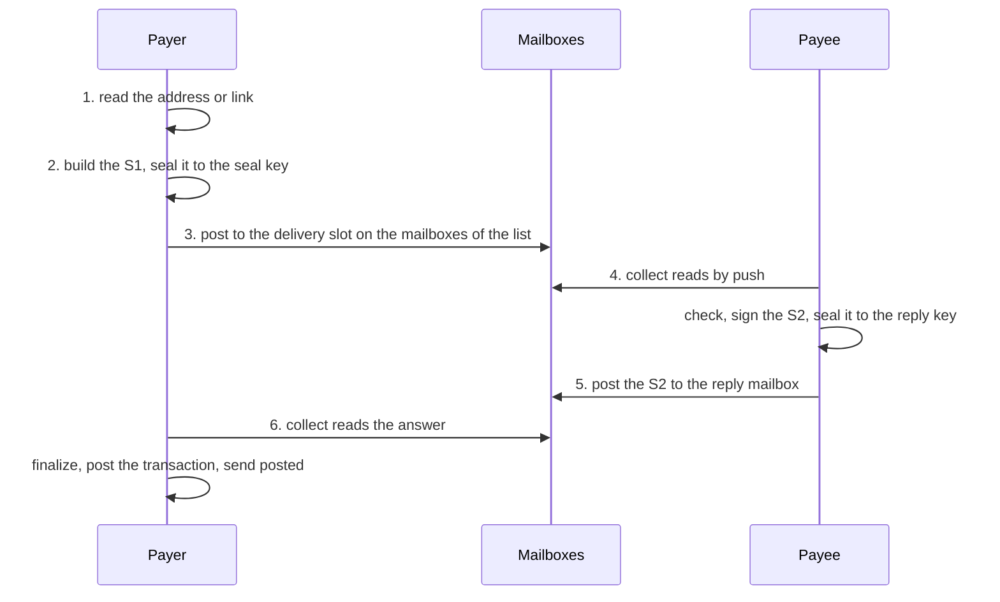

# epic1 overview

An epic1 address is how one LEPIC wallet pays another with native, sealed slates. A classic
address is read by many wallets, so a LEPIC wallet sends it only the stock slates those wallets
read ([Legacy transactions](legacy-transactions.md)), and native payments get an address of
their own. The epic1 address holds everything a payer needs: it names no mailbox, so the payee can
change mailboxes without a new address, and delivery is a separate layer that the payee's settings
choose. [ADR 0062](adr/0062-the-address-decides-the-protocol.md) and
[ADR 0063](adr/0063-the-epic1-address-carries-its-own-mailbox.md) give the reasons;
[epic1](protocols/epic1.md) and [Delivery](protocols/delivery.md) are the full guides.

## The address

```text
data  = version (01) || seal key (32) || delivery key (33)     66 bytes
text  = bech32m("epic", data)    mainnet, 117 characters
        bech32m("tepic", data)   floonet, 118 characters
```

Payments are sealed to the **seal key**. The **delivery key**, read as an Epicbox key, is the
address's mailbox, the same on every mailbox. Both derive from the seed, the account, the network
and index 0, so each account has one address and a restore gives the same one. The address
names no mailbox, transport or index, and carries no proof key: an epic1 payment has no payment
proof. The payment link is the address, `epic:<address>`; a request link adds an amount, a
message or both, and only fills in the payer's Send screen
([The links](protocols/epic1.md#the-links)).

## The cryptography

| Part | What it is | Crate | Specified in |
|---|---|---|---|
| Address text | bech32m of the 66 bytes, lower case | `lepic-epic1` | [RFC 0003 §5.13](rfcs/0003-epictx-native-slates.md#513-epic1-address) |
| Seal and delivery keys | Keyed BLAKE2b-256 of the seed over a label and the account, network and index; X25519 and secp256k1 | `lepic-wallet` (`namespace`) | [RFC 0003 §5.2](rfcs/0003-epictx-native-slates.md#52-keys-and-derivation) |
| Envelope | HPKE base mode: DHKEM(X25519, HKDF-SHA256), HKDF-SHA256, ChaCha20-Poly1305; anonymous, hint zero | `lepic-seal` | [RFC 0003 §5.4](rfcs/0003-epictx-native-slates.md#54-hpke) |
| Padding | Padmé of the content length, at least 768 bytes | `lepic-seal` | [RFC 0003 §5.7](rfcs/0003-epictx-native-slates.md#57-padding) |
| Reply key and reply mailbox | One X25519 key and one mailbox per slate, derived from the seed and the slate id | `lepic-wallet-contacts`, `lepic-wallet` | [RFC 0002 §2.3](rfcs/0002-contact-pairing.md#23-one-time-reply-keys), [Reply keys](protocols/epictx.md#reply-keys) |
| Mailbox post | Epicbox message encryption and signature to the mailbox key | `lepic-epicbox` | [Epicbox](protocols/epicbox.md#messages) |

A mailbox learns which slot gets mail, when, the size, and the poster's IP address and post
key; it can drop, delay or replay a message, but it cannot read or change a sealed envelope
([RFC 0003 §7.1](rfcs/0003-epictx-native-slates.md#71-per-party)). Payments to one address
share its slot, while each answer goes to a reply slot of its own, so a mailbox cannot join
two payments by their reply mailbox.

## A payment



1. **Read.** `lepic epic1 read` (`epic1_read`) reads the address or link and stores nothing.
2. **Seal.** `lepic epic1 pay`, or `lepic tx send --to` with the address or link, builds the S1
   (`epic1_pay`) with a TTL of 10,080 blocks (7 days) unless the send sets one, and seals it with
   `TxKey::Epic1` to the address's seal key. The envelope carries the payer's reply key and the
   key of a one-time reply slot, and names no mailbox.
3. **Post.** The outbox posts the payment to the address's delivery slot on the 3 healthiest
   mailboxes of the payer's list, one copy per mailbox; it is posted when any mailbox takes it. A mailbox's health
   is shown and never drops it from the list. When the payer's list holds none of the shipped
   mailboxes and the pay call names none, the payment fails at once with a "no shared mailbox"
   error. A link with `http` or `tor` entries
   is posted to those entries instead, one at a time, and answered in the same request.
4. **Collect.** The payee's collect reads its delivery slot by mailbox push, opens the
   envelope with the account's seal key, checks it and signs the S2. Any amount is taken.
5. **Answer.** The payee seals the S2 to the reply key and posts it to the reply slot on
   the mailbox it read the payment on and the 2 healthiest others of its list
   ([ADR 0065 §3](adr/0065-mail-goes-where-the-receiver-reads.md#3-posting-one-rule-for-every-native-message)).
6. **Finalize.** The payer's collect reads the answer, checks it is the S2 of its S1, finalizes
   it and posts the transaction. For a payment that went to the mailbox, it then sends the
   payee a `posted` notice and asks the other mailboxes to drop their copies of the payment.
7. **Refusal.** A payee with `refuse_unsolicited_payments` on sends a `declined` notice to the
   reply mailbox for every payment to the address. The payer erases the send and frees its
   inputs.
8. **Deadline.** Once the chain reaches the payment's cutoff, its TTL height or the wallet's
   own limit for the transaction if that comes first, the outbox stops posting it, and the
   next refresh expires it if it was not finalized.

## Payment proofs

The payee's LEPIC wallet signs a payment proof into the S2. It says the owner of the address took
this amount in the transaction whose kernel it names, for this slate id, and it names no payer.
The payer checks it when it finalizes and keeps it with the payment if it holds; a missing or bad
proof does not stop the payment unless `--require-proof` or `epic1_require_proof` asks for one.
Anyone verifies the proof with only the address (`lepic proof verify`). See
[Payment proofs](protocols/epic1-receipt.md) and [CLI](cli.md#payment-proofs).

## What the host does

The collect reads by push and posts what the outbox owes, as
[Delivery](protocols/delivery.md#what-the-host-does) describes. An app calls `set_delivery`
after it opens the wallet, and the session runs the collect in a loop
([FFI](ffi.md#delivery-loop)); the CLI has `lepic contact collect`, and `lepic serve` collects
on its own ([CLI](cli.md#lepic-serve-and-the-wallet-api)).

## Limits

- An account has one epic1 address, at index 0. Numbered addresses and links made before this
  model are not read.
- A payment read on a second mailbox is not taken again; its stored answer is posted again,
  from the same outbox row.
- Invoices go only between paired contacts that the payer verified and allowed to send
  invoices; no invoice or pair request travels over an epic1 link.
